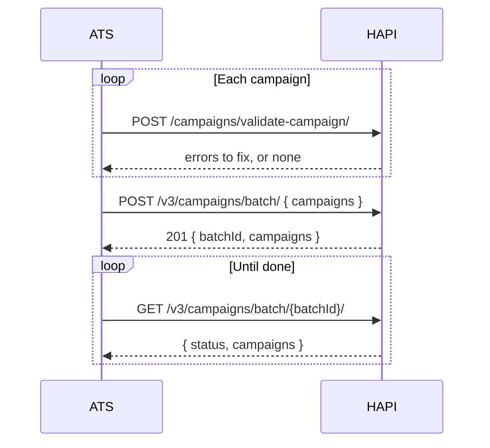

# Batch Ordering
> Order up to 20 campaigns in one call: all of them are created, or none is.

## Overview

A **batch** is a group of campaigns ordered together, for example the same job posted for several locations, or several jobs going to the same job boards. Each campaign of a batch is a regular campaign: it gets its own `campaignId`, and you track and edit it as you would a campaign ordered alone. Its body is exactly the body of a single [order](./ordering.md).

A batch adds three things:

- **One call for up to 20 campaigns.**
- **All or nothing.** When any campaign is refused, none is created, and the response shows which campaigns were refused and why.
- **One id to follow them.** The `batchId` returns the status of every campaign and a status for the whole batch, and takes every campaign offline in one call.

## How It Works



1. **Validate each campaign** with `POST /campaigns/validate-campaign/` or `POST /campaigns/order?validateOnly`, and fix its errors. See [Validation](./validation.md).
2. **Create the batch** with `POST /v3/campaigns/batch/`, sending the validated campaigns as they are.
3. **Follow the batch** with `GET /v3/campaigns/batch/{batch_id}/`, or follow each campaign with [Status & Lifecycle](./status.md) and [Webhooks](./webhooks.md).
4. **Cancel the batch**, when needed, with `PUT /v3/campaigns/batch/{batch_id}/cancellation/`. Each campaign can still be [cancelled](./cancellation.md) on its own.

## Endpoints

| Method | Path | Description |
|--------|------|-------------|
| POST | `/v3/campaigns/batch/` | Create up to 20 campaigns together |
| GET | `/v3/campaigns/batch/{batch_id}/` | Read a batch's campaigns and status |
| PUT | `/v3/campaigns/batch/{batch_id}/cancellation/` | Take a batch's campaigns offline |

See [Batch Ordering - Endpoint Reference](./batch-ordering.endpoints.md) for full request and response details.

## Validate Before You Create

<!-- theme: warning -->
> ### Job Boards Do Not Check a Batch
> Creating a batch does not ask the job boards to check each campaign's posting requirements. Every other check of a single order still runs: vacancy fields, products, contracts and duplicates. Validate each campaign first, or a campaign whose posting requirements a job board rejects is created anyway and fails later on that job board.

Validating separately keeps a batch fast: you can validate campaigns as the recruiter completes them, and the batch call itself only creates.

## Batch Status

The batch's `status` is derived from its campaigns' statuses, with the same rule a campaign applies to its products:

| Batch `status` | When |
|----------------|------|
| `online` | At least one campaign is `online` |
| `offline` | Every campaign is `offline` |
| `in progress` | Otherwise |

## Cancelling a Batch

`PUT /v3/campaigns/batch/{batch_id}/cancellation/` gives each campaign the answer a single [cancellation](./cancellation.md) would give it:

| `result` | When |
|----------|------|
| `accepted` | The campaign is `online`, or it is not and your account accepts cancelling a campaign that is not online |
| `refused` | The campaign is not `online` and your account asks for an error then (see [Cancelling a Non-Online Campaign](./cancellation.md#cancelling-a-non-online-campaign)). `error` holds the single cancellation's error body |

Like a single cancellation, it is asynchronous: the `202` answer is given at once, and the accepted `online` campaigns are taken offline in the background. Follow the batch's `status` until it is `offline`.

## Errors

When a campaign is refused, the response holds one entry per campaign, in the order you sent them: `{}` for a campaign that passed, and the error body a single `POST /campaigns/order` would return for a refused one. The HTTP status is the highest status among the refused campaigns, `400` or `403`.

```json
{
  "campaigns": [
    {},
    {"companyId": ["This value should not be blank."], "orderedProductsSpecs": [{}]},
    {}
  ]
}
```

Errors about the batch itself, such as an empty `campaigns` list or more than 20 campaigns, return `400` with field errors on `campaigns`.

## Edge Cases & Gotchas

- **No wallet payments.** A campaign with a `walletId` is refused: `A campaign of a batch cannot be paid from a wallet`.
- **No CPA+ products.** A campaign ordering a CPA+ product is refused: `A campaign of a batch cannot order a CPA product`.
- **One customer per batch.** Every campaign is ordered for the customer of the request's `X-Customer-Id` or JWT.
- **`validateOnly` and `verbose` do not apply.** A batch request always creates. Validate with the [validation endpoints](./validation.md) instead.
- **`loose=true` applies to every campaign**, as on a single order. See [Loose Validation](./validation.md#loose-validation).
- **Duplicate prevention applies.** When your account rejects duplicate orders, a campaign is refused if it repeats an earlier order or another campaign of the same batch.

## Related

- [Ordering](./ordering.md): the body of each campaign in a batch
- [Validation](./validation.md): validate each campaign before creating the batch
- [Status & Lifecycle](./status.md): follow each campaign after the batch is created
- [Cancellation](./cancellation.md): cancel a single campaign or product of a batch
- [Recipe: Batch Ordering](../../recipes/10-batch-ordering.md): build batch ordering into your ATS screen by screen, with test scenarios
