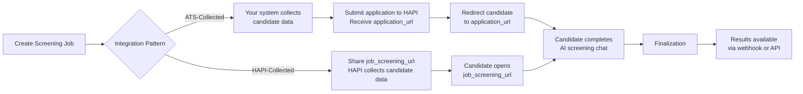

# Screening
> AI-powered candidate evaluation through interactive chat-screen applicants against job-specific criteria and receive scored PDF dossiers.

## What is Screening?

Screening is a standalone feature of the VONQ Hiring API (HAPI) that lets you evaluate candidates using an AI-driven chat conversation. You create a job, the AI writes the screening criteria from its description, candidates complete an interactive chat, and HAPI delivers a PDF dossier with AI-generated scores and evaluation summaries.

Screening operates independently from campaign ordering. You can use it on its own or alongside campaigns.

<!-- theme: warning -->
> ### Account Activation Required
> Screening must be enabled for your account by your VONQ account manager. API calls return `403` if screening is not enabled.

## How It Works

HAPI supports two integration patterns for collecting candidate data:

1. **ATS-Collected**-Your system collects candidate information (name, email, phone, resume) and submits it to HAPI. You receive an `application_url` and redirect the candidate to complete the AI chat.

2. **HAPI-Collected**-You create a screening job with public applications enabled. HAPI provides a `job_screening_url` that you share with candidates. HAPI collects their information directly before starting the AI chat.

Both paths converge: the candidate completes an AI-powered screening conversation, and HAPI finalizes the results.

Key behaviors:

- Shortly after job creation, the AI writes the screening requirements from the job description. `requirements_ready_at` marks when the job's `requirements` list is filled in, and a [job event webhook](./webhooks.md#job-events) can notify you. From then on you can reword them, add your own and remove the ones you do not want.
- If a candidate returns to the same `application_url`, they resume from where they left off.
- `finalization_time_hours` (1–168, default 168 = 7 days) controls when applications expire. The deadline is not extended for a candidate who is mid-conversation when it passes.
- Requirements guide the questions the AI asks and how it evaluates the answers. Candidates can be asked a requirement's `question`, as written or rephrased by the AI, so keep it suitable for them to read.
- The AI chat language is detected from the job description when the job is created. Dutch, English, French, German, Portuguese and Spanish are supported; anything else falls back to English.
- You receive results via webhook notifications or by polling the API.

## Key Concepts

**Screening Job**-A job configured for AI screening. Contains a job description, company information, the requirements the AI prepares from them, and settings like `finalization_time_hours`. Created once per vacancy and receives many applications. Its content and settings are fixed after creation. You can still edit its requirements and interview questions, or soft-delete the job.

**Application**-A single candidate's screening session. Created via the API (ATS-collected) or via the public URL (HAPI-collected, flagged as `is_external_application`). A candidate can resume their session by returning to the same URL.

**Requirement**-A screening criterion defined with three fields: `summary` (label), `description` (context the AI uses to score answers), and `question` (what to ask the candidate, which the AI may rephrase). The AI writes a job's requirements from its description, so you cannot supply them when creating the job. Once they are ready you can edit them.

**Dossier**-An AI-generated PDF containing screening results: candidate answers, an evaluation summary, and scores. Available after finalization. On `screened_timeout` it is included only when one could be generated, and it reflects only what was collected before the deadline.

**Finalization**-The point when screening results become available. Triggered when a candidate completes the chat or when `finalization_time_hours` expires. Results can arrive shortly after the deadline while answers already given are evaluated.

**Job Status**-Lifecycle states of a screening job:

| Status | Description |
|--------|-------------|
| `created` | Job is active and accepting applications |
| `stopped` | Job reached the end of `settings.duration_days` (1–365, default 60); no new applications accepted |
| `deleted` | Job soft-deleted by the ATS |

**Application Status**-Lifecycle states of an application: `created`, `screened_success`, `screened_timeout`, `deleted`.

**Application Stage**-Position in the screening funnel: `APPLIED`, `SCREENED`, `INTERVIEWED`. Independent of status.

**Screening Score**-`screened_score`, an integer from 0 to 250 (higher is better), matching the score in the dossier PDF. `null` until a score is available. A `screened_timeout` application can still have one, based only on what was collected before the deadline, usually the resume.

## What's Next

- [Jobs & Applications](./jobs-and-applications.md)-Create screening jobs, submit and manage applications, download dossier PDFs
- [Webhooks](./webhooks.md)-Receive real-time screening result notifications via webhook
