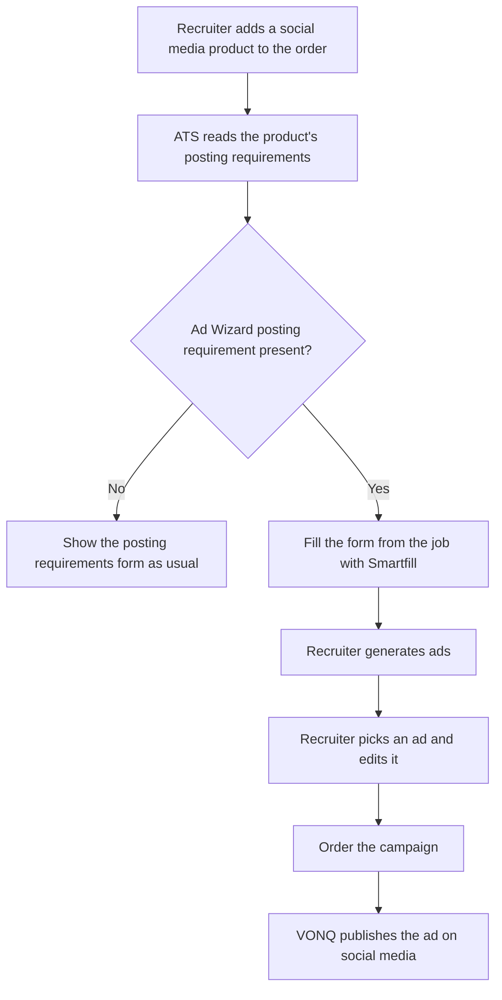

# HAPI EQO Attract
> Recruiters can generate social media job ads with EQO Attract in seconds. The text and images are automatically generated from the job description or can be manually added.

## What is HAPI EQO Attract?

**EQO Attract** is VONQ's AI ad builder. Through the VONQ Hiring API (HAPI), it works inside your ATS for social media products: when a recruiter orders one, they can generate complete ads from the job instead of writing them, compare a few, pick one and order the campaign as usual.

When selecting the Social Media product, the user will see the relevant fields required to post the ad on the specific channels, like Meta or TikTok. For Meta, these are:

- **Headline**, **primary text** and **description**, written within the platform's length limits
- **A picture** made for the ad, or one the recruiter uploads

The recruiter stays in control. A generated ad fills the posting requirements and every field is editable. The user can upload their own image and ask just for the text to be generated and vice-versa. Or they can generate the entire ad using the AI ad creator.

HAPI EQO Attract creates the job ad. VONQ runs the campaign on social media as it does for any channel. Settings such as budget, audience and placements are not part of the order form, and lead forms and chat ads are not offered through this product.

## How It Works

1. **Discover**: a product that supports EQO Attract carries an extra posting requirement of type `GENERATOR`, the **Ad Wizard**. Its presence is the signal; there is no product list to maintain.
2. **Generate**: a Smartfill task naming the Ad Wizard writes a few alternative ads. The text arrives within seconds and each picture follows within about a minute.
3. **Apply and order**: the chosen ad's values go into the ordinary posting requirements, and the campaign is ordered with `POST /campaigns/order` like any other.

## Key Concepts

- **Ad Wizard**-the `GENERATOR` posting requirement that marks a product as supporting EQO Attract. It declares which posting requirements an ad fills, whether it makes pictures, and the slants a recruiter can ask for. It is configuration, not a field to render.
- **Alternative**-one generated ad: values for the ad's posting requirements and, when pictures are made, an image URL hosted by VONQ.
- **Angle**-a slant a regeneration can lean on, such as more benefit-led or more urgent.
- **Outputs**-what one generation makes: text and pictures (the default), text alone, or pictures alone.
- **Preview**-a posting requirement that renders the ad as it will look on the channel, from the values in the form.

## Availability

- **Enabled per partner.** Your VONQ Account Manager turns it on. Once enabled, `smartfill.generators` and `smartfill.posting_requirements` are `true` in `GET /v3/ats/atsuser/me/settings/`. While `smartfill.generators` is off, the Ad Wizard is absent from the product's posting requirements and the product works like any other.
- **Social media products set up for it.** Products that support it carry the Ad Wizard posting requirement. Read it from the product's specs rather than keeping a list of product IDs.
- **Nothing extra to order.** The campaign is ordered and tracked like any other Job Marketing campaign.

## What's Next

- [Building the Ad Form](ad-form.md)-the recommended recruiter experience, screen by screen, with screenshots from the VONQ HAPI Demo
- [AI Ad Creatives](../07-posting-requirements/ai-ad-creatives.md)-the API reference: discovering the Ad Wizard, generating, polling, previews and applying a result
- [Smartfill-Hiding Pre-filled Fields](../07-posting-requirements/smartfill.md#hiding-pre-filled-fields)-filling the fields an ad does not write, such as the Facebook page
