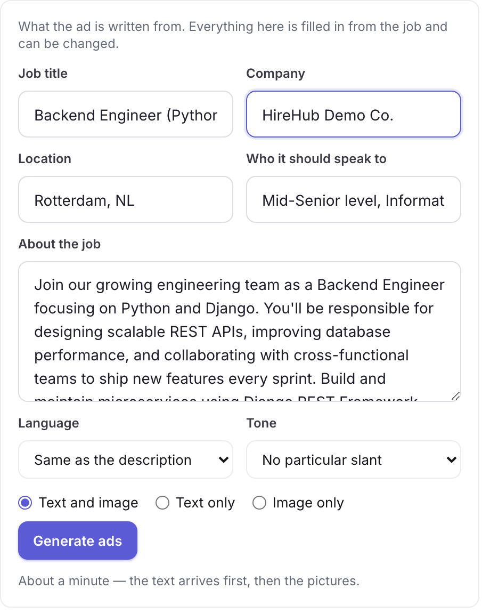
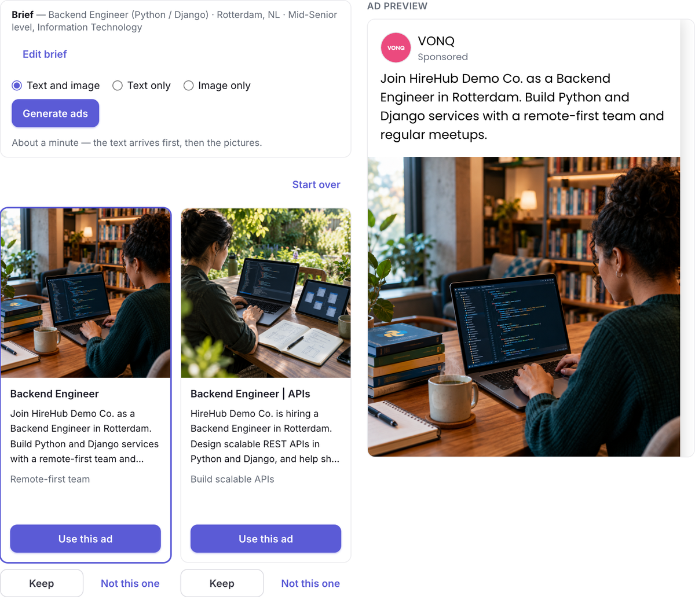
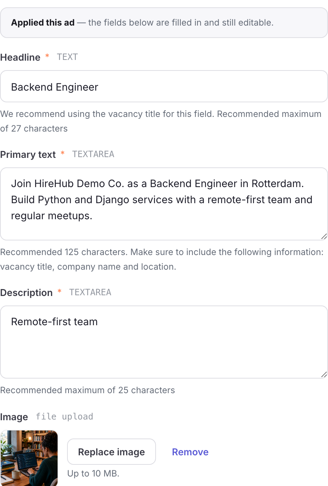

# Building the Ad Form
> What the recruiter sees when ordering a social media product with EQO Attract, and which API call is behind each step.

## Overview

This page walks through the posting requirements step of an order for a product that carries the Ad Wizard. The screenshots come from **VONQ's HAPI Demo**, which uses only the public API. Your UI can look different; the structure is what we recommend.

The form for such a product has three parts:

1. **The Ad Wizard**-a brief and a choice of what to generate
2. **The ads**-a few alternatives to compare, with a preview
3. **The form**-the posting requirements that are sent with the order, filled by the ad the recruiter picks and still editable

See [HAPI EQO Attract](01-introduction.md) for what the feature is, and [AI Ad Creatives](../07-posting-requirements/ai-ad-creatives.md) for the full API reference.

## When the Form Opens

Read the product's posting requirements with `GET /products/{product_id}/specs/`. When one of them is of type `GENERATOR`, show the Ad Wizard above the form. Do not render the `GENERATOR` facet itself as a field.

Then fill the form from the job with a Smartfill task asking only for the fill (`"jobs": ["fill"]`). This fills the fields an ad does not write, such as the Facebook page the ad runs from. Start this task as soon as the form opens, without waiting for the recruiter to press a button: the page is required and is usually kept out of sight, so it has to be filled whether or not the recruiter generates an ad. Leave the ad's own fields, the generator's `targets`, to the ad the recruiter picks: do not apply the fill's values for them. A field the recruiter has no reason to change can be kept out of sight once it holds a value; see [Hiding Pre-filled Fields](../07-posting-requirements/smartfill.md#hiding-pre-filled-fields).

## 1. The Brief

The brief is what the ads are written from. Fill it in from the job and let the recruiter change it before generating:

| In the brief | Sent as |
|---|---|
| Job title, company, location, audience, description | `context` |
| Language | `language` |
| Tone | `generator.angle`, one of the `angles` the Ad Wizard declares |

The choice below the brief sets `generator.outputs`:

| Choice | `generator.outputs` | When |
|---|---|---|
| Text and image | left out | The default: complete ads |
| Text only | `["text"]` | The recruiter has their own picture |
| Image only | `["media"]` | The recruiter wants pictures for text they wrote |

Generating creates a task on `POST /v3/smartfill/posting-requirements/` naming the Ad Wizard in `generator`, with `"jobs": ["generator"]` because the form is already filled. See [Text or Pictures Alone](../07-posting-requirements/ai-ad-creatives.md#text-or-pictures-alone).

## 2. Picking an Ad

Poll the task with `GET /v3/smartfill/posting-requirements/{task_id}/` and show each alternative as soon as its text arrives; its picture follows. We recommend:

- **Two at a time.** A pair is a choice; a wall of five is a survey. Turning one down ("Not this one") brings forward the next alternative the run already wrote.
- **A preview beside the ads.** Render the ad the recruiter is looking at through the product's preview posting requirement. See [Rendering a Preview](../07-posting-requirements/ai-ad-creatives.md#rendering-a-preview).
- **A way to ask again.** A new generation, optionally with an angle, adds to the ads rather than replacing them.

"Use this ad" writes the alternative's `values`, and its picture's `media.value`, into the posting requirements listed in the Ad Wizard's `targets`, and nothing else.

## 3. The Ad in the Form

The form below the Ad Wizard holds every posting requirement that is sent with the order. After "Use this ad", the ad's fields are filled in and stay editable, and the recruiter can still fill the form by hand without generating at all.

- **The image field is an upload.** It is a `TEXT` posting requirement with a `mimetype` rule: render a file picker, host the uploaded file and submit its URL. A generated picture is already hosted by VONQ. See [Facets-Validation Rules](../07-posting-requirements/facets.md#validation-rules).
- **Keep the ad's fields on screen.** Show and submit every field in the Ad Wizard's `targets`, even when one is optional, so a chosen ad is never dropped from the order.
- **Order as usual.** The values go into `orderedProductsSpecs[].postingRequirements` on `POST /campaigns/order`.

## When Pictures Do Not Arrive

Sometimes an ad comes back without a picture. Once `generator.status` is final, an ad without `media` will not get one.

| What you see | What to do |
|---|---|
| Some ads have no picture | Show them like the others. The recruiter can upload a picture, or generate pictures alone and use one of those. |
| No ad has a picture | The same. If it happens on every generation, contact your VONQ Account Manager: picture generation may not be enabled for your account. |
| `generator.status` is `errored` and there are no ads | Nothing usable was made. Say so and keep the form available, so the recruiter can fill it in by hand. |

Stop showing progress once `generator.status` is final; nothing more will arrive.

## Edge Cases & Gotchas

<!-- theme: warning -->
> **Let the recruiter review before ordering.** Generated ads are best-effort. Never order an ad the recruiter has not seen.

<!-- theme: warning -->
> **Never block ordering on the Ad Wizard.** A generation that fails, or a partner without `smartfill.generators`, leaves the ordinary form, which the recruiter can always fill in by hand.

<!-- theme: info -->
> **Generations take time.** Text arrives in seconds and pictures within about a minute. Show the text as soon as it arrives. See [How Long It Takes](../07-posting-requirements/ai-ad-creatives.md#how-long-it-takes).

<!-- theme: info -->
> **Pictures cost.** Each alternative with a picture renders one. Ask for text alone when the recruiter brings their own picture.

## Related

- [HAPI EQO Attract](01-introduction.md)-what the feature is and how to enable it
- [AI Ad Creatives](../07-posting-requirements/ai-ad-creatives.md)-the API reference
- [Smartfill](../07-posting-requirements/smartfill.md)-the create-then-poll pattern, and hiding pre-filled fields
- [Facets](../07-posting-requirements/facets.md)-posting requirement types and validation rules
