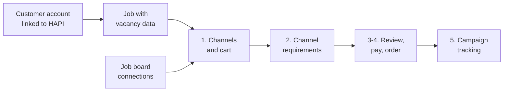

# Recipes

> Build a VONQ Hiring API (HAPI) integration screen by screen: for each screen of a standard ATS ordering flow, the calls it makes, the data it keeps, and the tests that prove it works.

## What Are Recipes?

The guides explain one concept at a time, and the [scenarios](../guides/14-scenarios/01-introduction.md) walk through the API calls of one task in order. Recipes start from the screens of your ATS instead: what the recruiter sees and does, which calls each action triggers, what your ATS must store, where ATSs integrate differently, and the test scenarios that tell you a screen is done.

Recipes are written so that an AI coding agent can implement an integration from them while a developer reviews the result. Each recipe is one unit of work. It links to the guides and scenarios for payload details instead of repeating them.

If you would rather embed VONQ's ready-made UI than build your own screens, use [HAPI Elements](https://docs.elements.hapi.vonq.com/) and its recipes.

## The Standard Ordering Flow

The recipes follow the flow of a typical ATS. Each customer account is linked to HAPI once. A recruiter then promotes a job through a wizard: choose channels, fill in channel requirements, review and pay, then track the result. Job board connections can be managed on a settings page or opened from inside the wizard.



| When | Screen | Recipe |
|------|--------|--------|
| Once per customer | Account settings | [Customer Accounts](./02-customer-accounts.md) |
| Per job | Job form | [Job to Vacancy](./03-job-to-vacancy.md) |
| Wizard step 1 | Channels and cart | [Channel Selection](./04-channel-selection.md) |
| Any time, or from step 1 | Job board connections | [Job Board Connections](./05-job-board-connections.md) |
| Wizard step 2 | Channel requirements | [Posting Requirements Form](./06-posting-requirements-form.md) |
| Wizard steps 3-4 | Review, payment, place order | [Checkout and Order](./07-checkout-and-order.md) |
| Wizard step 5 and after | Campaign status on the job | [Campaign Tracking](./08-campaign-tracking.md) |
| Before go-live | None | [End-to-End Testing](./09-end-to-end-testing.md) |

Direct Apply, AI Screening, CPA+ and wallet top-ups build on this flow and are covered by their guides: [Direct Apply](../guides/10-direct-apply/01-introduction.md), [Screening](../guides/11-screening/01-introduction.md), [CPA+](../guides/09-cpa.md) and [Wallets & Payments](../guides/12-wallets-and-payments.md).

## Anatomy of a Recipe

Every recipe uses the same sections, in this order:

| Section | What it gives you |
|---------|-------------------|
| **UI Moment** | Where the screen sits in the flow and what the recruiter does on it |
| **Integration Variants** | Decisions where ATSs differ, and what each choice changes |
| **Build** | The steps: user action, API call, what to show |
| **Store** | What your ATS persists, and why |
| **Rules** | Behaviors that break integrations when ignored |
| **Validate** | Test scenarios with stable IDs, each as Given / When / Then |
| **Done When** | The checklist a reviewer signs off |

Scenario IDs such as `CHN-03` are stable. Use them in test names, bug reports and support requests so that everyone refers to the same check. Most scenarios run against [Sandbox](../02b-environments.md); the few that need a real job board say so.

## Using Recipes with an AI Coding Agent

1. Clone `vonq/hapi-docs` next to your codebase, or give your agent its URL.
2. Put your Sandbox secret key in an environment variable. Never paste it into a prompt or commit it.
3. Give the agent a prompt along these lines:

```text
Implement the VONQ HAPI job advertising integration in this codebase.
Follow docs/recipes/ in vonq/hapi-docs in order, one recipe per task.
For each recipe: build its steps into our existing job and settings
screens, persist its Store fields, and turn its Validate scenarios into
automated tests that run against the HAPI Sandbox. The OpenAPI schema
(schema/build/public.json) is the authority for paths and payloads.
Ask me before choosing an option under Integration Variants.
```

4. Review each recipe against its **Done When** checklist and its test results before moving on to the next one.

## Source Authority

Recipes follow the authority order in [`AGENTS.md`](https://github.com/vonq/hapi-docs/blob/master/AGENTS.md): the OpenAPI schema defines exact paths, parameters, payloads and responses; guides, scenarios and recipes explain meaning and order. If a recipe and the schema disagree, the schema wins. Report the conflict to your VONQ account manager.

## What's Next

Start with [Customer Accounts](./02-customer-accounts.md).
