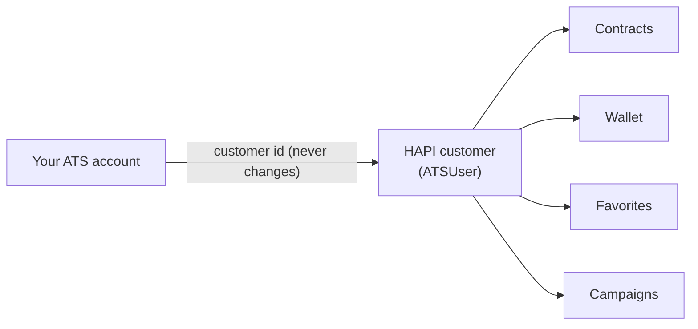

# Customer Accounts

> Every recruiter action in HAPI happens on behalf of one of your customers. Link each customer account of your ATS to a HAPI **customer** (ATSUser) once, read what that customer may use, and route every call through one server-side client.

## UI Moment

There is usually no screen for this. It happens when a customer account is created in your ATS, or the first time someone in it opens a VONQ feature. Many ATSs also show an **Integration status** panel in their admin settings, fed by the calls below.



## Integration Variants

| Decision | Options | What changes |
|----------|---------|--------------|
| What one HAPI customer represents | One ATS customer company (most common), or a region, business unit or recruiter | Contracts, wallets, favorites and campaigns belong to one customer and cannot move. Choose once; see [Partitioning Strategies](../guides/03-authentication-and-users/entities.md#partitioning-strategies) |
| Where calls are made | Your server only (recommended), or the browser with a JWT | JWT must be enabled for your partner account by VONQ |
| When the customer is created | On account creation with `POST /v3/ats/users/`, or on first use through any customer-scoped call | Both are covered in Step 3 |

## Build

### Step 1: Check the partner key

```http
GET https://marketplace-sandbox.api.vonq.com/v3/ats/ats/me/ HTTP/1.1
X-Auth-Token: <your Partner token here>
```

Returns `id`, `name` and `hapi_partner_id`. Use it as a health check when your app starts and on the integration status panel. Do not send `X-Customer-Id` on this call.

### Step 2: Choose the customer ID

Use an identifier your ATS already has for the account and that never changes or gets reused, such as the account's primary key. It must be at most 255 characters and must not contain `/`. HAPI cannot rename or delete customers.

### Step 3: Create or confirm the customer

```http
GET https://marketplace-sandbox.api.vonq.com/v3/ats/atsuser/me/ HTTP/1.1
X-Auth-Token: <your Partner token here>
X-Customer-Id: <customer-id>
```

The first call with a new `X-Customer-Id` creates the customer; later calls return it. The response echoes `customer_id`.

To create the customer at the moment the account is created in your ATS, call the partner-level endpoint instead (without `X-Customer-Id`):

```http
POST https://marketplace-sandbox.api.vonq.com/v3/ats/users/ HTTP/1.1
X-Auth-Token: <your Partner token here>
Content-Type: application/json

{ "customer_id": "<customer-id>" }
```

It returns `201` with a new customer, or `200` with the existing one. Partner-level tools can also list customers with `GET /v3/ats/users/` and read one with `GET /v3/ats/users/{customer_id}/`. See [Entities](../guides/03-authentication-and-users/entities.md).

### Step 4: Read the customer's settings

Call `GET /v3/ats/atsuser/me/settings/` once per session and cache the result briefly. VONQ manages these settings; your integration reads them and shows or hides features:

| Setting | Used by |
|---------|---------|
| `products.ai_recommendations_enabled` | [Channel Selection](./04-channel-selection.md): AI recommendations |
| `smartfill.vacancy_fields`, `smartfill.product_search_filters`, `smartfill.posting_requirements` | Smartfill prefill in [Job to Vacancy](./03-job-to-vacancy.md), [Channel Selection](./04-channel-selection.md) and [Posting Requirements Form](./06-posting-requirements-form.md) |
| `campaigns.loose_validation` | Which vacancy fields may be left out with `?loose=true` |
| `campaigns.enable_weekly_working_minutes` | Whether `weeklyWorkingMinutes` may replace `weeklyWorkingHours` |
| `ats_managed_payment`, `can_use_wallets`, `can_pay_with_purchase_order`, `can_pay_with_direct_charge` | [Checkout and Order](./07-checkout-and-order.md): payment options |

### Step 5: Browser calls with a JWT (optional)

If part of your UI calls HAPI from the browser, your server mints a token per customer:

```http
POST https://marketplace-sandbox.api.vonq.com/v3/ats/users/{customer_id}/generate-jwt-token/ HTTP/1.1
X-Auth-Token: <your Partner token here>
```

The response is `201` with `token`. The browser sends `X-Authorization: Bearer <token>` instead of the secret key. Tokens expire (7 days unless VONQ configured otherwise); mint a new one when a call returns `401`. See [Authentication](../guides/03-authentication-and-users/authentication.md#jwt-authentication).

### Step 6: One HTTP client for every recipe

Route all HAPI calls through one module on your server that:

- Reads the base URL and secret key from configuration, per environment.
- Adds `X-Auth-Token`, `X-Customer-Id` (on customer-scoped calls) and `Accept-Language`.
- Uses paths exactly as in the OpenAPI schema, trailing slashes included.
- Backs off and retries on `429`.
- Logs every call with the secret key masked.

## Store

| What | Why |
|------|-----|
| HAPI customer ID per ATS account | Sent as `X-Customer-Id` on every customer-scoped call |
| The environment the customer lives in | Sandbox and Production customers are separate |
| The secret key per environment, server side only | Authentication |
| Settings, cached briefly | Feature gating without a call per page |
| `hapi_partner_id` (optional) | Some embeddable widgets, such as the payment widget, need it |

## Rules

1. Partner-level calls (`/v3/ats/ats/me/`, `/v3/ats/users/` and below, `generate-jwt-token`) must not carry `X-Customer-Id`; with it they return `403`.
2. Every other call that acts for a customer needs `X-Customer-Id`. Without it, customer-scoped calls return `403`. Always send it on orders.
3. A new `X-Customer-Id` silently creates a new, empty customer, even if you create your customers with `POST /v3/ats/users/`. Take the ID from your database, never from user input, or a typo creates a stray customer.
4. The secret key never leaves your server. Browsers get a JWT.
5. Keys, customers and settings exist per environment. Sandbox and Production have nothing in common.
6. Paths under `/v3/` without their trailing slash return `404`. Copy paths from the OpenAPI schema.
7. Budget 60 requests per 60 seconds for your partner account and back off on `429`. See [Rate Limits](../02-api-overview.md#rate-limits).
8. Settings change on VONQ's side. Do not hard-code which features a customer has.

## Validate

Run these against Sandbox with a new test customer ID such as `recipe-<random>`.

| ID | Given | When | Then |
|----|-------|------|------|
| `ACC-01` | A Sandbox secret key | `GET /v3/ats/ats/me/` with only `X-Auth-Token` | `200` with `id`, `name`, `hapi_partner_id` |
| `ACC-02` | The same key | `GET /v3/ats/ats/me/` with `X-Customer-Id` added | `403` |
| `ACC-03` | An unused customer ID | `GET /v3/ats/atsuser/me/` with that `X-Customer-Id`, then `GET /v3/ats/users/?customer_id=<id>` | `200` echoing `customer_id`; the list then holds that customer |
| `ACC-04` | The same key | `GET /v3/ats/atsuser/me/` without `X-Customer-Id` | `403` |
| `ACC-05` | JWT enabled for the partner account | `POST /v3/ats/users/{customer_id}/generate-jwt-token/`, then `GET /v3/ats/atsuser/me/` with only `X-Authorization: Bearer <token>` | `201` with `token`; `200` with the same `customer_id` |
| `ACC-06` | A customer | `GET /v3/ats/atsuser/me/settings/` | `200`; `settings.smartfill` and `settings.products` hold booleans; the UI hides features that are `false` |
| `ACC-07` | A customer | `GET /v3/ats/atsuser/me` (no trailing slash) | `404` |
| `ACC-08` | An unused customer ID | `POST /v3/ats/users/` with that `customer_id` twice, then with `customer_id: "a/b"` | `201`, then `200` with the same `id`; `400` for `a/b` |

## Done When

- [ ] Each ATS account maps to exactly one stable HAPI customer ID, stored in your database.
- [ ] All HAPI calls go through one server-side client that adds the headers, masks the key in logs and backs off on `429`.
- [ ] Features are shown or hidden from the customer's settings.
- [ ] If the browser calls HAPI, it uses a JWT minted by your server and renews it on `401`.
- [ ] Scenarios `ACC-01` to `ACC-08` pass (`ACC-05` only if you use JWT).

## Related

- [Entities](../guides/03-authentication-and-users/entities.md): partner, customer, partitioning
- [Authentication](../guides/03-authentication-and-users/authentication.md): secret key and JWT
- [API Overview](../02-api-overview.md): headers, errors, rate limits
- Next recipe: [Job to Vacancy](./03-job-to-vacancy.md)
