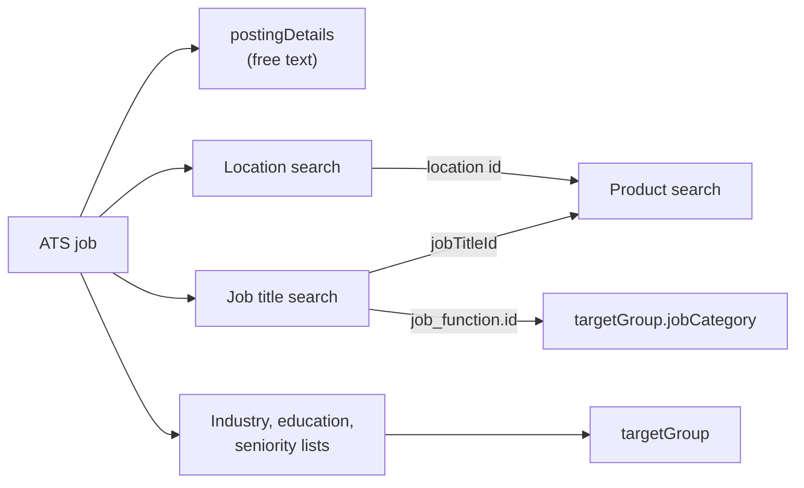

# Job to Vacancy

> Every order starts from a job your ATS already has. Map its fields onto the HAPI vacancy, and collect the taxonomy IDs that drive product search and targeting, ideally once when the job is saved.

## UI Moment

The recruiter creates or edits a job: title, description, location, employment type, hours, salary, application URL. To advertise it through HAPI, the job also needs a few VONQ choices, either on the job form or on the review step of the wizard:

- **Job title** (type-ahead) or **job function** (tree): drives product search.
- **Location** (type-ahead): drives product search.
- **Industry**, **education level** and **seniority** (selects): targeting.



## Integration Variants

| Decision | Options | What changes |
|----------|---------|--------------|
| Where taxonomy is chosen | Pickers on your job form, a mapping table from your own taxonomy to VONQ IDs, Smartfill, or a mix | A mapping table needs no UI, but taxonomy values change; refresh it and fall back to a picker when a value no longer exists |
| Job title not in the taxonomy | Keep the free-text title and pick a job function instead, or use Smartfill | The vacancy title is always free text; only product search uses the taxonomy title |
| Strict or loose | Fill every required field, or leave out the fields VONQ configured as loose for your account and send `?loose=true` | Loose works only on accounts where VONQ enabled it |

## Build

### Step 1: Load and cache the lists

| List | Call | Notes |
|------|------|-------|
| Education levels | `GET /taxonomy/education-levels` | Small, flat |
| Seniority | `GET /taxonomy/seniority` | Small, flat |
| Industries | `GET /products/industries/?limit=100` | Plain array, no pagination fields |
| Job functions | `GET /products/job-functions/` | Tree |

Cache them per environment and per language (`Accept-Language`), and refresh daily.

### Step 2: Job title type-ahead

`GET /products/job-titles/?text=<typed text>` returns up to 10 titles. Each has an `id`, a localized `name` and a `job_function` with `id` and `name`. Store the title `id` (for product search) and the `job_function.id` (for `targetGroup.jobCategory`).

Matching is on whole words, prefixes and small typos, across languages. A single word that is not in the taxonomy returns nothing, while two words can match on one of them: "Caregiver" may return no results where "Care giver" returns care titles. When nothing fits, keep the recruiter's free-text title for the vacancy and ask for a job function from the tree instead.

### Step 3: Location type-ahead

`GET /products/location/search/?text=<typed text>` returns places with `id`, `canonical_name`, `fully_qualified_place_name`, `place_type` and `within` (the chain of parent places up to the continent):

| Typed text | What comes back |
|------------|-----------------|
| A city, district, region or country ("Amsterdam", "Bavaria", "Germany") | Matching places of those types |
| A continent name in English ("Europe", "Asia", "North America") | The continent, first in the list |
| A group of countries that is not a continent ("Middle East", "DACH", "Benelux") | Nothing that covers those countries. Let the recruiter pick the countries one by one |

The location `id` is for product search only (`includeLocationId` or `exactLocationId`; see [Channel Selection](./04-channel-selection.md)). The vacancy's working location is free text: fill `postingDetails.workingLocation` (`addressLine1`, `postcode`, `city`, `country`) from the job's address, not from the search target. A job in Amsterdam can still be advertised Europe-wide.

### Step 4: Map the job fields

| ATS job field | HAPI field | Rule |
|---------------|------------|------|
| Title | `postingDetails.title` | Free text |
| Description | `postingDetails.description` | HTML allowed |
| Company name and logo | `postingDetails.organization.name`, `.companyLogo` | Logo: public URL, JPEG, PNG, GIF or WebP |
| Address | `postingDetails.workingLocation` | `country` takes a name or ISO code |
| Required experience | `postingDetails.yearsOfExperience` | Integer |
| Contract type | `postingDetails.employmentType` | One of `permanent`, `temporary`, `fixed_term`, `fixed_term_with_option_for_permanent`, `freelance`, `traineeship`, `internship` |
| Hours per week | `postingDetails.weeklyWorkingHours` (`from`, `to`) | Or `weeklyWorkingMinutes` where the account enables it; exactly one of them |
| Salary | `postingDetails.salaryIndication` (`range`, `period`) | Optional |
| Careers page and apply link | `postingDetails.jobPageUrl`, `.applicationUrl` | Valid URLs |
| Contact person | `postingDetails.contactInfo` | Optional |
| Recruiter | `recruiterInfo.name` (plus optional `id`, `emailAddress`) | Name required |

Field details: [Vacancy Fields](../guides/08-campaigns/vacancy-fields.md).

### Step 5: Build `targetGroup`

Each of the four dimensions holds exactly one item, `{"vonqId": "<id as string>", "description": "<label>"}`:

| Dimension | ID from |
|-----------|---------|
| `educationLevel` | `GET /taxonomy/education-levels` |
| `seniority` | `GET /taxonomy/seniority` |
| `industry` | `GET /products/industries/` |
| `jobCategory` | A job function: the job title's `job_function.id`, or `GET /products/job-functions/` |

```json
{
  "targetGroup": {
    "educationLevel": [{ "vonqId": "2", "description": "Bachelor / Graduate" }],
    "seniority": [{ "vonqId": "3", "description": "Senior" }],
    "industry": [{ "vonqId": "7", "description": "IT" }],
    "jobCategory": [{ "vonqId": "54", "description": "Software Development" }]
  }
}
```

### Step 6: Prefill with Smartfill (optional)

When `settings.smartfill.vacancy_fields` is on, `POST /v3/smartfill/vacancy-fields/` with the job as `context` (`structured` fields you already have, `unstructured` text of at least 32 characters), then poll `GET /v3/smartfill/vacancy-fields/{task_id}/` until `status` is `completed` or `errored`. `prefill_data` grows while the task runs; offer its values to the recruiter, never submit them unseen. `prefill_data.taxonomy.jobFunction` belongs in `targetGroup.jobCategory`. See [Campaign Smartfill](../guides/08-campaigns/smartfill.md).

### Step 7: Validate when the job is saved

`POST /campaigns/validate-vacancy-info/` with `{"vacancy": {...}}` (`companyId`, `recruiterInfo`, `postingDetails`, `targetGroup`) returns `200` when complete and `422` with errors per field. Validating on save means the wizard rarely stops on vacancy problems. See [Campaign Validation](../guides/08-campaigns/validation.md).

## Store

| What | Why |
|------|-----|
| Job title `id` and `job_function` (`id`, `name`), or a chosen job function | Product search seed; `targetGroup.jobCategory` |
| Location `id` values for the advertising area | Product search seed |
| `vonqId` and label for each `targetGroup` dimension | Order body |
| The job's address as text fields | `postingDetails.workingLocation` |
| Cached taxonomy lists per environment and language | Pickers without repeated calls |

Taxonomy and location IDs differ between Sandbox and Production. Store them per environment.

## Rules

1. Each `targetGroup` dimension takes exactly one item. Two items return "Maximum number of items is 1."; an empty list fails strict validation.
2. `jobCategory` takes a job function ID, not a job title ID. An ID that is not a job function returns "VonqId ... not found".
3. `vonqId` is the taxonomy `id` sent as a string. `description` must not be blank; any readable label works.
4. A location `id` never goes into the vacancy. `workingLocation` is the job's real address; the search area can be wider.
5. Location search has no areas between country and continent. Use several country IDs for groups such as the Middle East.
6. `companyLogo` is downloaded by HAPI: it must be publicly reachable within a few seconds and be JPEG, PNG, GIF or WebP. SVG is rejected.
7. Send exactly one of `weeklyWorkingHours` and `weeklyWorkingMinutes`.
8. With loose validation, leave the loose fields out. Sending them empty (`""`) is still an error.
9. Job title search returns at most 10 results. Debounce the type-ahead and do not page past them.
10. On Sandbox, location search finds only places Sandbox already knows, so smaller towns can be missing there.

## Validate

| ID | Given | When | Then |
|----|-------|------|------|
| `VAC-01` | None | `GET /products/location/search/?text=Amsterdam` | `200`; a result whose `place_type` contains `place` and whose `within` chain reaches a country and a continent |
| `VAC-02` | None | `GET /products/location/search/?text=Europe`, then `GET /products/search/?includeLocationId=<its id>` | The first result's `place_type` contains `continent`; the product search returns `200` |
| `VAC-03` | None | `GET /products/location/search/` without `text` | `400` |
| `VAC-04` | None | `GET /products/job-titles/?text=developer` | `200` with at most 10 results, each with `job_function.id` |
| `VAC-05` | A complete vacancy with `jobCategory` set to a job function ID | `POST /campaigns/validate-vacancy-info/` | `200`, `has_errors: false` |
| `VAC-06` | The same vacancy with `jobCategory` `vonqId: "999999"` | `POST /campaigns/validate-vacancy-info/` | `422`, "VonqId 999999 not found" |
| `VAC-07` | The same vacancy with two `educationLevel` items, or `employmentType: "full-time"` | `POST /campaigns/validate-vacancy-info/` | `422` on the offending field |
| `VAC-08` | The same vacancy with an unreachable or SVG `companyLogo` | `POST /campaigns/validate-vacancy-info/` | `422` on `postingDetails.organization.companyLogo` |

## Done When

- [ ] Every job can produce a complete `postingDetails`, `recruiterInfo` and `targetGroup` without manual JSON.
- [ ] Job title, location and targeting pickers use the taxonomy endpoints, with lists cached per environment and language.
- [ ] Search locations and the working address are kept apart.
- [ ] A job without a matching taxonomy title can still be advertised through a job function.
- [ ] Vacancy validation runs when the job is saved and shows errors on the right fields.
- [ ] Scenarios `VAC-01` to `VAC-08` pass.

## Related

- [Taxonomy & Locations](../guides/04-taxonomy.md): every taxonomy endpoint
- [Vacancy Fields](../guides/08-campaigns/vacancy-fields.md): every field of the vacancy
- [Campaign Validation](../guides/08-campaigns/validation.md): strict and loose validation
- [Campaign Smartfill](../guides/08-campaigns/smartfill.md): prefill from the job text
- Next recipe: [Channel Selection](./04-channel-selection.md)
