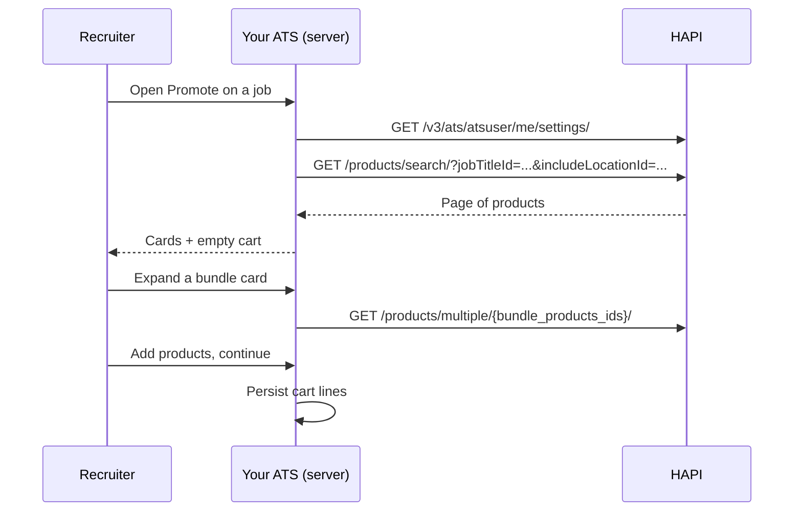

# Channel Selection

> Wizard step 1: the recruiter picks where to advertise the job. Your ATS searches the VONQ marketplace with filters taken from the job, explains bundles, offers favorites and AI recommendations, and keeps the choice in a cart.

## UI Moment

The recruiter clicks **Promote** on a job that already has vacancy data (see [Job to Vacancy](./03-job-to-vacancy.md)). The first step of the wizard shows:

- A search and filter bar, pre-filled from the job: job title or job function, location, industry.
- Product cards with logo, title, price, duration and an **Add** button.
- A cart panel with the selected products and a running total.
- Optionally, a **Recommend for me** action and a **My job boards** tab listing the customer's own contracts (see [Job Board Connections](./05-job-board-connections.md)).



## Integration Variants

| Decision | Options | What changes |
|----------|---------|--------------|
| Entry point | Search first, recommendations first, or both | Recommendations require the account setting `products.ai_recommendations_enabled` |
| Seeding the filters | Your own mapping to taxonomy IDs, Smartfill, or both | Smartfill requires `smartfill.product_search_filters` and is asynchronous |
| Favorites | Pin on page 1 (`injectFavorites=true`), a filter (`favorites=true`), or a separate tab (`GET /products/multiple/favorites/`) | Pinned favorites ignore filters and are not counted in `count` |
| Cart storage | Server side per job, or browser only | Server side survives reloads and lets the recruiter duplicate a campaign later |
| Contract products | Same grid as marketplace products, or a separate **My job boards** tab | Contract-only products never appear in search; they come from the contract |

## Build

### Step 1: Detect the optional features

Call `GET /v3/ats/atsuser/me/settings/` once per session and read:

| Setting | Enables |
|---------|---------|
| `settings.products.ai_recommendations_enabled` | **Recommend for me** (Step 6) |
| `settings.smartfill.product_search_filters` | Seeding the filters with Smartfill (Step 2) |

Hide the actions the customer cannot use. Calling them anyway returns `403`.

### Step 2: Seed the filters from the job

Use the taxonomy IDs stored on the job (see [Job to Vacancy](./03-job-to-vacancy.md)):

| Job data | Search parameter |
|----------|------------------|
| Job title ID, or job function ID (never both) | `jobTitleId` or `jobFunctionId` |
| Location IDs | `includeLocationId` (comma-separated) or `exactLocationId` |
| Industry IDs | `industryId` (comma-separated) |

If the job has no taxonomy IDs yet, Smartfill can derive them from the job text: `POST /v3/smartfill/product-search-filters/` with `{"context": {"unstructured": "<job text>"}}`, then poll `GET /v3/smartfill/product-search-filters/{task_id}/` every few seconds until `status` is `completed` or `errored`. `prefill_data` holds `job_title`, `job_function`, `location` and `industry` when found. If both `job_title` and `job_function` come back, search with `job_title` only. See [Campaign Smartfill](../guides/08-campaigns/smartfill.md).

### Step 3: Search and render the cards

```http
GET https://marketplace-sandbox.api.vonq.com/products/search/?jobTitleId=1234&includeLocationId=2384&industryId=7&currency=EUR&limit=24&offset=0 HTTP/1.1
X-Auth-Token: <your Partner token here>
X-Customer-Id: <customer-id>
Accept-Language: en
```

The full parameter list is in [Marketplace](../guides/05-products/02-marketplace.md). The ones a channels screen needs:

| Purpose | Parameters |
|---------|------------|
| Free text on product names | `name` |
| Targeting | `jobTitleId` or `jobFunctionId`, `includeLocationId`, `exactLocationId`, `industryId` |
| Duration | `durationFrom`, `durationTo` (days) |
| Narrow by kind | `isBundle`, `mcEnabled`, `hasProductSpecs`, `features=direct_apply` |
| Order | `sortBy` (`relevant` by default) |
| Personal | `injectFavorites`, `favorites`, `injectTopOrdered`, `topOrdered`, `recommendationId` |
| Prices | `currency` (`EUR`, `USD`, `GBP`, `AUD`) |
| Paging | `limit`, `offset` |

The response is paginated: `count`, `next`, `previous`, `results`. Fields a product card needs:

| Field | Use |
|-------|-----|
| `product_id` | Cart line ID. Keep it as a string: IDs mix UUIDs and numeric strings |
| `title`, `channel.name`, `logo_square_url`, `logo_rectangle_url` | Card header |
| `vonq_price[]` | Price in the requested currency (what the customer is charged by VONQ) |
| `duration` | How long the ad runs |
| `time_to_process`, `time_to_setup` | Delivery estimate. Read `range` before converting; do not assume days |
| `bundle_products_ids`, `cpa` | Bundle and CPA+ detection (Step 4) |
| `has_product_specs`, `product_specs.validation_optional` | Whether step 2 needs a requirements form for this product |
| `features.direct_apply`, `features.requires_salary_indication` | Obligations that show up later in the flow |
| `is_favorite` | Heart icon state |

### Step 4: Show what a bundle contains

A product is a real **bundle** when `bundle_products_ids` is a non-empty array and `cpa` is `null`. Do not rely on `type` or the `isBundle` filter alone: some CPA+ products match those too. See [Special Products](../guides/05-products/03-special-products.md).

To list the contents ("this bundle contains X, Y and Z"), resolve the IDs:

```http
GET https://marketplace-sandbox.api.vonq.com/products/multiple/{bundle_products_ids joined with ","}/?limit=50 HTTP/1.1
X-Auth-Token: <your Partner token here>
X-Customer-Id: <customer-id>
```

Pass the IDs through exactly as returned. Children the customer cannot see are left out of the response without an error, so compare the returned `product_id` values with the manifest.

What the recruiter should understand from the card:

- **Price**: the bundle's own `vonq_price` is the price. Do not add up the children.
- **Ordering**: only the bundle's `product_id` goes into `orderedProducts`. If a child has posting requirements, step 2 collects them for that child (see [Posting Requirements Form](./06-posting-requirements-form.md)).
- **After ordering**: the campaign lists the bundle and each child, each with its own status. A bundle of three products shows four product IDs. See [Bundles in Campaigns](../guides/08-campaigns/bundles.md).

### Step 5: Favorites

| Action | Call |
|--------|------|
| Heart on | `POST /v3/products/favorites/` with `{"product_id": "<id>"}` |
| Heart off | `DELETE /v3/products/favorites/{product_id}/` |
| Favorites tab | `GET /products/multiple/favorites/` |

Favorites are stored per customer (`X-Customer-Id`), not in your ATS. See [Product Favorites](../guides/05-products/05.favorites.md).

### Step 6: AI recommendations (optional)

1. `POST /v3/products/recommendations/` with the vacancy criteria you have (`postingDetails.title`, `postingDetails.description`, `postingDetails.workingLocation.city` and `country`, `targetGroup.industry`, `targetGroup.jobCategory`) and `exclude_ids` set to the products already in the cart. The response is `202` with the job `id`.
2. Poll `GET /v3/products/recommendations/{id}/` every few seconds until `status` is `completed`, `failed` or `expired`. Stop after a timeout you choose and fall back to the normal search.
3. Show the result with `GET /products/search/?recommendationId={id}`. Each entry in `recommendations[]` has a `reason` you can show on the card.

Job category, industry and city or country decide which products are eligible. Title and description give the ranking its context. See [Product Recommendations](../guides/05-products/05.recommendations.md).

### Step 7: Keep the cart

- Total: the sum of `vonq_price` in the chosen currency. Keep one currency per cart.
- Delivery estimate for the whole cart: `GET /products/delivery-time/{products_ids}/` returns `days_to_process`, `days_to_setup` and `total_days`, taken as the maximum across the products.
- Restore after a reload: `GET /products/multiple/{ids}/?limit=<number of ids>` and drop any line that no longer comes back.
- Contract lines come from [Job Board Connections](./05-job-board-connections.md): they carry a `contract_id` and the contract's `product.product_id`.

## Store

| What | Source | Why |
|------|--------|-----|
| Cart line `product_id` (string) | Search result | Becomes `orderedProducts[]` at checkout |
| Bundle `bundle_products_ids` | Bundle product | Step 2 collects child requirements; tracking groups child statuses under the bundle |
| Cart line `contract_id` and contract `product.product_id` | Contract | Becomes `orderedProductsSpecs[].contractId` at checkout |
| Cart currency | Recruiter choice | One currency per order |
| `recommendationId` (optional) | Recommendation job | Lets the recruiter return to the recommended list; jobs expire, so check the status before reusing one |

Do not store favorites (HAPI keeps them) or product availability (read it again when the cart is restored).

## Rules

1. Send `X-Customer-Id` on every call. Search results, favorites and recommendations are per customer.
2. Contract-only products (`mc_only: true`) never appear in `/products/search/`. They come from the customer's contracts.
3. Products the customer cannot order are left out of search and multiple results, and `GET /products/single/{product_id}/` returns `404` for them. Re-read the cart on restore and tell the recruiter which lines were dropped.
4. Unknown query parameters are ignored without an error, so a misspelled filter returns the unfiltered catalog. There is no public price or channel filter.
5. `jobTitleId` and `jobFunctionId` together return `400`. Send one of them.
6. `currency` narrows the price arrays; it does not filter products.
7. `injectFavorites` and `injectTopOrdered` pin up to 10 products on page 1, ignore your filters, and are not counted in `count`. They are ignored when `favorites`, `topOrdered` or `recommendationId` is set.
8. `recommendationId` works only for a `completed` job of the same customer: unknown IDs return `404`, malformed or unfinished ones return `400`. It cannot be combined with a custom `sortBy` or with `recommended` / `excludeRecommended`. Other filters still apply and can hide recommended products, so clear them when showing recommendations.
9. `GET /products/multiple/` accepts up to 50 IDs, silently drops unknown ones, and pages its results: pass `limit`.
10. `GET /products/delivery-time/` returns `404` if any ID is unknown or repeated. Remove duplicates first.
11. Debounce search-as-you-type and keep your traffic within the budget in [Rate Limits](../02-api-overview.md#rate-limits).
12. Errors on `/products/*` paths arrive wrapped in an `error` object, for example `{"error": {"non_field_errors": ["..."]}}`.

## Validate

Run these against Sandbox with `X-Customer-Id` set. Discover IDs in the environment you test; do not reuse Production IDs.

| ID | Given | When | Then |
|----|-------|------|------|
| `CHN-01` | Job title ID `J` and location ID `L` from the taxonomy | `GET /products/search/?jobTitleId=J&includeLocationId=L&currency=EUR&limit=24` | `200`; every `vonq_price` holds exactly one `EUR` entry; no result has `mc_only: true` |
| `CHN-02` | Job title ID `J`, job function ID `F` | `GET /products/search/?jobTitleId=J&jobFunctionId=F` | `400` "Cannot search by both job title and job function" |
| `CHN-03` | A search result `B` with non-empty `bundle_products_ids` and `cpa: null` | `GET /products/multiple/{B.bundle_products_ids}/?limit=50` | `200`; every returned `product_id` is in the manifest; the UI lists them as the bundle contents |
| `CHN-04` | Cart lines `A`, `B` | `GET /products/multiple/A,B,A,unknown-id/?limit=50` | `200` with exactly `A` and `B`; the cart drops `unknown-id` and says so |
| `CHN-05` | Cart lines `A`, `B` | `GET /products/delivery-time/A,B/`, then `GET /products/delivery-time/A,A/` | `200` with `total_days`; then `404` (deduplicate before calling) |
| `CHN-06` | Product `A` is not a favorite | `POST /v3/products/favorites/` twice, then `GET /products/search/?favorites=true`, then `DELETE /v3/products/favorites/A/` twice | `201`, then `200`; `A` listed with `is_favorite: true`; `204`, then `404` |
| `CHN-07` | `ai_recommendations_enabled` is on; `A` is in the cart | `POST /v3/products/recommendations/` with a title, a city and country, and `exclude_ids: [A]`; poll; then `GET /products/search/?recommendationId={id}` | `202`; status reaches `completed`; `A` is not recommended; search returns only recommended products, in their order |
| `CHN-08` | A recommendation job that is still `queued` or `running` | `GET /products/search/?recommendationId={id}` | `400` "The recommendation is not completed."; a random UUID returns `404` |
| `CHN-09` | A contract whose `product.product_id` is `P` with `mc_only: true` | `GET /products/search/?name=<channel name>`, then `GET /products/single/P/` | `P` is not in the search results; `single` returns `200` with `mc_only: true` |
| `CHN-10` | `smartfill.product_search_filters` is on | `POST /v3/smartfill/product-search-filters/` with job text, poll, then search with the returned IDs | `201`; status reaches `completed`; the seeded search returns `200` |

## Done When

- [ ] The channels step opens with filters taken from the job, and the recruiter can change them.
- [ ] Cards show price in one currency, duration and delivery estimate, using the fields above.
- [ ] Bundles are detected by `bundle_products_ids` and `cpa`, and can be expanded to show their contents.
- [ ] Favorites and recommendations appear only when the account settings allow them.
- [ ] The cart survives a reload and drops lines that are no longer available, with a message.
- [ ] Contract products are added from the customer's contracts, not from search.
- [ ] Scenarios `CHN-01` to `CHN-10` pass, or are skipped because the feature is disabled for the account.

## Related

- [Marketplace](../guides/05-products/02-marketplace.md): every search parameter and response field
- [Special Products](../guides/05-products/03-special-products.md): bundles and CPA+ detection
- [Product Favorites](../guides/05-products/05.favorites.md) and [Product Recommendations](../guides/05-products/05.recommendations.md)
- [Bundles in Campaigns](../guides/08-campaigns/bundles.md): what a bundle looks like after ordering
- [Job Marketing Campaign](../guides/14-scenarios/job-marketing-ordering.md): the same flow as a call-by-call walkthrough
- Next recipe: [Posting Requirements Form](./06-posting-requirements-form.md)
