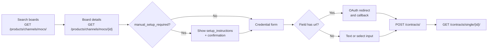

# Job Board Connections

> Let a recruiter connect a job board account they already pay for, so your ATS can post to it through HAPI. The connection is stored as a **contract**.

## UI Moment

Recruiters reach connections in two places:

- A **Job board connections** settings page: a list of connected boards with a status, and a **Connect a board** action.
- The **My job boards** tab of the channels step (see [Channel Selection](./04-channel-selection.md)): connected boards to add to the cart, and a shortcut to connect a new one and return to the wizard.

Connecting a board is a short wizard: find the board, read its setup instructions, fill in its credential form, confirm.



## Integration Variants

| Decision | Options | What changes |
|----------|---------|--------------|
| When contracts are created | Upfront on a settings page (most ATSs), or inline during checkout | Inline: check for an existing contract first, save the wizard state across an OAuth redirect, and create the contract before validating the order. The order body cannot carry credentials |
| Credential check | `credentials_validation: "if_supported"`, or omitted | `if_supported` checks the credentials with the board where the board supports it, and is harmless elsewhere. Recommended |
| More than one account on the same board | Default group only, or extra contract groups | One contract per channel per group. A second account on the same board (another brand or business unit) needs its own group |
| Credential collection | Your own form built from the board's fields, or your own existing credential store | Either way, the keys you send must match the board's credential field names exactly |

### Inline creation during checkout

Some ATSs collect board credentials in their own UI and create the contract while the recruiter orders, instead of upfront. That works with the same calls in this order:

1. `GET /contracts/?channel_id={channel_id}` to reuse an existing contract for that board.
2. If there is none: `GET /products/channels/mocs/{id}/`, collect credentials, then `POST /contracts/`.
3. `GET /contracts/single/{contract_id}/` to get the contract's `product.product_id` and posting requirements.
4. Continue with [Posting Requirements Form](./06-posting-requirements-form.md) and [Checkout and Order](./07-checkout-and-order.md).

Keep the contract after the order: HAPI needs it to edit or take down the posting later.

## Build

### Step 1: List connections

`GET /contracts/` returns the customer's contracts. Filter with `channel_id`, `search`, `group_id` or `label[<key>]=<value>`. Show `channel.name`, `alias` and a status from `has_errors`.

### Step 2: Find a board

`GET /products/channels/mocs/?search=seek` lists channels that accept contracts. Show `name` and logo.

### Step 3: Show the board's setup and credential form

`GET /products/channels/mocs/{id}/` (send `X-Customer-Id`) returns:

| Field | Use |
|-------|-----|
| `manual_setup_required`, `setup_instructions` | If `true`, show the HTML instructions and a confirmation checkbox |
| `feed_url` | For boards that read a job feed: show it so the recruiter registers it on the board |
| `contract_credentials[]` | The credential form: `name`, `label`, `description`, `sort`, plus `url` or `options` |
| `product.product_id` | The product this contract orders |

Render each credential field by this rule:

| Condition | Render as |
|-----------|-----------|
| `url` present | **Connect with {board}** button (OAuth) |
| `options` present | Select, values from `options[].key` |
| Neither | Text input |

Boards that read a job feed also list an `xml_feed_url` credential ("Confirmed XML Feed URL"). Prefill it with the board's `feed_url`.

### Step 4: OAuth fields

1. Save the form state under a random flow ID (for example in the session) and redirect the recruiter to `{url}?callbackUrl=<URL-encoded callback in your ATS>`. Use `&` instead of `?` if `url` already has a query string.
2. The recruiter signs in on the board.
3. Your callback receives the credential in the `hash` query parameter (`?hash=<value>`). Accept a URL fragment as a fallback.
4. Restore the form and put the value into the credential field.

Some boards need OAuth and typed fields together (for example XING: OAuth plus `organization_id`). See [Contract Caveats & Notes](../guides/06-contracts/notes.md#oauth-credentials).

### Step 5: Create the contract

```http
POST https://marketplace-sandbox.api.vonq.com/contracts/ HTTP/1.1
X-Auth-Token: <your Partner token here>
X-Customer-Id: <customer-id>
Content-Type: application/json

{
  "channel_id": 1234,
  "alias": "SEEK - Sydney office",
  "credentials": {
    "agency_or_company": "Company",
    "organization_id": "<organization id>"
  },
  "credentials_validation": "if_supported"
}
```

Add `"followed_instructions": true` only when `manual_setup_required` is `true`, and `group_id` only for an extra group. Then fetch `GET /contracts/single/{contract_id}/` for the posting requirements and the product ID. Full request and response: [Managing Contracts](../guides/06-contracts/managing-contracts.md).

### Step 6: Second account on the same board

`POST /igb/contracts/groups/` with `{"name": "Brand B"}` returns a group `id`. Pass it as `group_id` when creating the second contract. A group cannot be changed after the contract is created.

### Step 7: Fix or remove a connection

- **Credentials changed or broken**: `PATCH /contracts/single/{contract_id}/` with the full new `credentials` and `credentials_validation: "if_supported"`. The `contract_id` stays the same, so campaigns already posted with it stay manageable.
- **Disconnect**: `DELETE /contracts/{contract_id}/` returns `204` even when campaigns still use the contract. Those campaigns become unmanageable: edits and takedowns fail, and the posting may stay live on the board. Check your own records for live campaigns on the contract, and take them offline before deleting. See [Deleting Contracts with Active Campaigns](../guides/06-contracts/notes.md#deleting-contracts-with-active-campaigns).

### Step 8: Offer connections in checkout

In the **My job boards** tab, list contracts without errors. A cart line for a contract carries the `contract_id` and the contract's `product.product_id`. At checkout, `GET /contracts/multiple/{contracts_ids}/` (up to 50 IDs) refreshes them in one call.

## Store

| What | Source | Why |
|------|--------|-----|
| `contract_id` | `POST /contracts/` | `orderedProductsSpecs[].contractId` at checkout |
| `channel_id`, `alias`, `labels` | Contract | List and search connections in your UI |
| `product.product_id` | Contract | `orderedProducts[]` at checkout. Contract-only products are not in search |
| `group.id` | Contract | Every contract in one order must share it |
| `contract_id` per ordered line | Order | Later edits and takedowns of that posting |

Do not store credentials. Text credentials come back encrypted and cannot be read back; select values come back as plain values.

## Rules

1. `GET /products/channels/mocs/{id}/` needs `X-Customer-Id`; without it the call returns `403`. If your HTTP client does not follow redirects, call it without the trailing slash.
2. Credential keys must equal `contract_credentials[].name` exactly. A missing, unknown or empty key returns `400` under `credentials`.
3. Send `followed_instructions: true` only when `manual_setup_required` is `true`. Sending it otherwise, or leaving it out when it is required, returns `400`.
4. One contract per channel per group. A second one returns `400` "The contract for the same channel already exists in this group." Reuse the existing contract or use another group.
5. All contracts in one order must be in the same group. Mixing groups makes `POST /campaigns/order` return `403` "All contracts must be part of the same contracts group".
6. The product ID and the contract ID go in different places: `product.product_id` in `orderedProducts[]`, `contract_id` in `orderedProductsSpecs[].contractId`.
7. `PATCH` cannot change `group_id` (`400`) and silently ignores `credits`, `expiry_date` and `purchase_price` (`200`, values unchanged). See [Contract Immutability](../guides/06-contracts/notes.md#contract-immutability).
8. A contract has no status field. `has_errors` and `errors[]` report problems that appear after creation, such as "Credential format is changed" when the board changed its credential fields: ask the recruiter for new credentials and `PATCH`. The error can take up to an hour to clear after a fix.
9. A contract with errors cannot be validated or ordered. Hide it from the cart or show it as needing attention.
10. Contract posting requirements defaults (`posting_requirements_defaults`) are stored as given and never applied by HAPI. Prefill your requirements form from them yourself.

## Validate

Run these against Sandbox. Boards with real credential checks (SEEK) need a real board account; see [End-to-End Testing](./09-end-to-end-testing.md).

| ID | Given | When | Then |
|----|-------|------|------|
| `CON-01` | A partner key and no `X-Customer-Id` | `GET /products/channels/mocs/?search=seek`, then `GET /products/channels/mocs/{id}` | `200` for the list; `403` for the detail |
| `CON-02` | A channel with `manual_setup_required: false` | `POST /contracts/` with `followed_instructions: true` | `400` on `followed_instructions` |
| `CON-03` | The board's credential names | `POST /contracts/` with one credential left out | `400` "The `<name>` credential is missing" under `credentials` |
| `CON-04` | Valid credentials for the board | `POST /contracts/` with `credentials_validation: "if_supported"`, then `GET /contracts/single/{id}/`, then `GET /contracts/` | `201` with `errors: []` and `product.product_id` set; detail lists `posting_requirements`; list row has `has_errors: false` |
| `CON-05` | A contract for channel `X` in the default group | `POST /contracts/` for `X` again; then `POST /igb/contracts/groups/`; then `POST /contracts/` for `X` with the new `group_id` | `400` on `group_id`; `201` with the group `id`; `201` |
| `CON-06` | Contracts on two boards in different groups | `POST /campaigns/order` with both `contractId` values | `403` "All contracts must be part of the same contracts group"; no campaign created |
| `CON-07` | An existing contract | `PATCH /contracts/single/{id}/` with `group_id`, then with `credits: 5` | `400` "Cannot change the contract group once it is set"; `200` with `credits` unchanged |
| `CON-08` | An existing contract | `DELETE /contracts/{id}/` twice | `204`, then `404` |
| `CON-09` | A board with an OAuth credential field (needs a real board account) | Redirect to `{url}?callbackUrl=<callback with state>`, sign in, then `POST /contracts/` with the returned value | Callback receives `?hash=<value>` and your `state`; contract created with `201` |

## Done When

- [ ] Recruiters can list, connect, fix and disconnect job boards, with `has_errors` shown as a status.
- [ ] The credential form is built from `contract_credentials`, including OAuth buttons, selects and manual setup confirmation.
- [ ] An OAuth round trip returns the recruiter to the same form with the other fields intact.
- [ ] Connected boards appear in the channels step and carry `contract_id` and `product.product_id` into the cart.
- [ ] Orders never mix contracts from different groups.
- [ ] Credentials are never stored in your ATS database or logs.
- [ ] Scenarios `CON-01` to `CON-08` pass; `CON-09` passes for each OAuth board you support.

## Related

- [Contracts](../guides/06-contracts/01-introduction.md) and [Managing Contracts](../guides/06-contracts/managing-contracts.md): fields, groups, labels
- [Contract Caveats & Notes](../guides/06-contracts/notes.md): OAuth, feed setup, credential validation, immutability
- [Setting Up a Contract](../guides/14-scenarios/contract-setup.md): the same flow as a call-by-call walkthrough
- [Ordering with Contracts](../guides/06-contracts/ordering.md): using a contract in an order
- Next recipe: [Posting Requirements Form](./06-posting-requirements-form.md)
