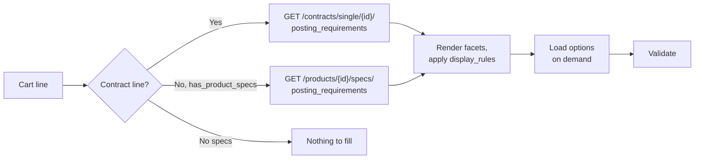

# Posting Requirements Form

> Wizard step 2: some channels need extra, channel-specific fields before they accept a job. Your ATS builds a form for each of them from the definitions HAPI returns, and checks the answers before checkout.

## UI Moment

After the recruiter leaves the channels step, the wizard lists every cart line that needs extra details, each with a completion mark. Selecting a line opens its form. Lines that need nothing show "No extra details needed".

A form can contain text and number inputs, selects, multi-selects, tree selects, type-ahead fields whose options come from the board, and fields that appear only after an earlier choice. A typical Job Post board chains them: location, then job category (options depend on the location), then ad type (options depend on both).



## Integration Variants

| Decision | Options | What changes |
|----------|---------|--------------|
| Where definitions come from | Contract lines: the contract. Marketplace lines: the product specs. While creating a contract: the board details | Each source has its own options endpoint (Step 3) |
| Prefill | Contract `posting_requirements_defaults`, Smartfill, the recruiter's previous order, or nothing | All of them only fill the form; the recruiter confirms and you validate |
| Validation timing | When leaving each form, or once at checkout | Per form gives faster feedback; both end with `validate-campaign` at checkout |
| Optional specs | Products with `product_specs.validation_optional: true` | The recruiter may skip the form for that line |

## Build

### Step 1: Decide which cart lines need a form

| Cart line | Needs a form when | Definitions from |
|-----------|-------------------|------------------|
| Contract product | Always check | `GET /contracts/single/{contract_id}/` returns `posting_requirements[]` and `posting_requirements_defaults` |
| Marketplace product | `has_product_specs: true` | `GET /products/{product_id}/specs/` returns `posting_requirements[]` |
| Bundle | Any child has `has_product_specs: true` | One form per child, keyed by the child's `product_id` |

`GET /products/{product_id}/specs/` returns `404` for a product without specs, so check `has_product_specs` first.

### Step 2: Render each facet

Each facet in `posting_requirements[]` becomes one field. Key properties:

| Property | Use |
|----------|-----|
| `name` | Field key. Case-sensitive; submit it exactly |
| `label`, `sort` | Field label and order |
| `type` | Widget: `TEXT`, `TEXTAREA`, `HTMLAREA`, `SELECT`, `MULTIPLE`, `HIER`, `AUTOCOMPLETE`, `DATE`, `STATISCH` (display only) and others |
| `required`, `rules[]`, `message` | Client-side checks (`maxlength`, `regex`, `email`, `url`, and so on) |
| `options[]` | Fixed options. Empty together with a non-null `autocomplete` means "load on demand" |
| `autocomplete` | How to load options: `required_parameters` and `parameters_source` |
| `display_rules.show[]` | When the field is visible |

Per-type details: [Facets](../guides/07-posting-requirements/facets.md). Visibility logic: [Facets - Display Rules](../guides/07-posting-requirements/facets-display-rules.md).

### Step 3: Load options on demand

Use the endpoint that matches the cart line, with the facet `name` in the path:

| Cart line | Call | Body |
|-----------|------|------|
| Contract product | `POST /contracts/posting-requirements/{contract_id}/{facet name}/` | `{"term": "<search text>"}` |
| Marketplace product | `POST /products/{product_id}/specs/facets/{facet name}/options/` | `{"term": "<search text>"}` |
| While creating a contract (no contract yet) | `POST /contracts/posting-requirements/{channel_id}/{facet name}/` | `{"term": "...", "credentials": {...}}` |

The response is a list of `{key, label}` options. When `parameters_source.term` names other facets, `term` is an array of their values in that order. Pass keys that contain special characters (such as `§`) through unchanged. When a parent value changes, clear its dependent fields and load their options again. See [Autocomplete](../guides/07-posting-requirements/autocomplete.md).

Facets with `is_data: true` produce a preview instead of options: `POST /products/{product_id}/specs/facets/{facet_name}/data/` with `{"values": {...}}`.

### Step 4: Prefill (optional)

- **Contract defaults**: copy `posting_requirements_defaults` from the contract into the form. HAPI never applies them on its own.
- **Smartfill**: when `settings.smartfill.posting_requirements` is on, `POST /v3/smartfill/posting-requirements/` with either `contract_id` or `product_id` (never both) and the job as `context`, then poll `GET /v3/smartfill/posting-requirements/{task_id}/` every few seconds. `prefill_data` grows as the task runs; keys already returned do not change. Fill only empty fields, submit option `key` values, show `label` values. See [Smartfill](../guides/07-posting-requirements/smartfill.md).

### Step 5: Validate each form

Contract lines (and marketplace lines that VONQ validates through its own contract) go to `POST /campaigns/validate-channel-posting/`. This endpoint is snake_case and takes posting requirements as a list:

```json
{
  "product_id": "d4e5f6a7-b8c9-0123-def0-234567890123",
  "contract_id": "c4d5e6f7-a8b9-0123-def0-234567890123",
  "posting_requirements": [
    { "name": "location", "value": "3000" },
    { "name": "seekAnzAdvertisementType", "value": "Classic" }
  ],
  "vacancy": [
    { "name": "applicationUrl", "value": "https://careers.example.com/jobs/123" }
  ]
}
```

- `200` with `has_errors: false`: the form is complete.
- `422` with `has_errors: true`: show `errors.posting_requirements.<facet name>` next to each field, and `errors.credentials` as a problem with the connection, not the form.
- `400` "Contract ID is required for this product" on a marketplace line: validate that line at checkout with `POST /campaigns/validate-campaign/` instead.

### Step 6: Build the order line

At checkout the same answers go into `orderedProductsSpecs[]` as a flat object:

```json
{
  "productId": "d4e5f6a7-b8c9-0123-def0-234567890123",
  "contractId": "c4d5e6f7-a8b9-0123-def0-234567890123",
  "postingRequirements": {
    "location": "3000",
    "seekAnzAdvertisementType": "Classic"
  }
}
```

Leave out hidden facets and `STATISCH` facets. See [Checkout and Order](./07-checkout-and-order.md).

## Store

| What | Why |
|------|-----|
| Per cart line: `productId`, `contractId` (if any) and the answers as `{name: value}` | Becomes `orderedProductsSpecs[]` |
| For options loaded on demand: the chosen `key` and `label` | Shows the answer again without reloading options; some boards change keys over time, so match by key, then by label |

Fetch facet definitions again for every wizard session. Boards change them.

## Rules

1. Facet names are case-sensitive, in paths and in payloads. A wrong case in an options path returns `404` "Facet not found".
2. For an existing contract, put the `contract_id` in the options path. A channel ID there is for contract setup only and can return fewer or no options.
3. Omit facets hidden by `display_rules`, even when `required: true`.
4. `required: false` does not mean optional to the board. Some boards (SEEK, for example) reject a posting without certain such fields. Always validate before ordering.
5. Never submit `STATISCH` facets. `HIER` takes leaf keys only. Option keys starting with `_optgroup-` are group headers, not values.
6. An option can make vacancy fields mandatory (for example an email application method requires `contactInfo.emailAddress`). Send those in `vacancy[]` when validating and in the vacancy data when ordering.
7. `validate-channel-posting` uses snake_case and a `{name, value}` list. The order uses camelCase and a flat object. A camelCase body returns `400` "This field is required."
8. A contract with errors cannot be validated: the call returns `400` on `contract_id`. Send the recruiter to fix the connection (see [Job Board Connections](./05-job-board-connections.md)).
9. Use `POST` with a `term` body for option search.

## Validate

Run these against Sandbox with a Job Post contract (SEEK is the worked example in the guides).

| ID | Given | When | Then |
|----|-------|------|------|
| `REQ-01` | A marketplace product with `has_product_specs: false` | `GET /products/{id}/specs/` | `404`; the UI shows "No extra details needed" without calling it |
| `REQ-02` | A SEEK contract | `POST /contracts/posting-requirements/{contract_id}/location/` with `{"term": "Sydney"}`, then the same with `Location` | `200` with `[{key, label}]`; then `404` "Facet not found" |
| `REQ-03` | A random UUID | `POST /contracts/posting-requirements/{uuid}/location/` with a `term` | `404` "Invalid channel or contract id" |
| `REQ-04` | A SEEK contract and product | `POST /campaigns/validate-channel-posting/` with camelCase `productId`, `contractId`, `postingRequirements` | `400`, `product_id` and `posting_requirements` "This field is required." |
| `REQ-05` | A SEEK contract-only product | `validate-channel-posting` without `contract_id` | `400` "Contract ID is required for this product" |
| `REQ-06` | A SEEK form with only the `required: true` facets filled | `validate-channel-posting` | `422`, `has_errors: true`, errors on facets such as `seekAnzAdvertisementType`; after filling them, `200` with `has_errors: false` |
| `REQ-07` | A SEEK ad type that hides the branding facets | `validate-channel-posting` without the hidden facets | No errors for the hidden facets |
| `REQ-08` | `smartfill.posting_requirements` is on | `POST /v3/smartfill/posting-requirements/` with `contract_id` and job context; poll | `201` with `smartfill_task_id`; status reaches `completed` or `errored`; `prefill_data` keyed by facet name. Sending `product_id` too returns `400` |

## Done When

- [ ] Every cart line that needs details gets a form; lines that don't are marked as complete.
- [ ] Forms are built from facet definitions at runtime, with no board-specific code.
- [ ] Dependent fields reload their options when a parent changes, and hidden fields are never submitted.
- [ ] Validation errors appear next to the right field; credential errors point to the connection.
- [ ] Answers survive moving back and forth in the wizard.
- [ ] Scenarios `REQ-01` to `REQ-08` pass, or are skipped because the feature is disabled for the account.

## Related

- [Posting Requirements](../guides/07-posting-requirements/01-introduction.md): concepts and facet sources
- [Facets](../guides/07-posting-requirements/facets.md), [Facets - Display Rules](../guides/07-posting-requirements/facets-display-rules.md), [Autocomplete](../guides/07-posting-requirements/autocomplete.md)
- [Validation](../guides/07-posting-requirements/validation.md) and [Smartfill](../guides/07-posting-requirements/smartfill.md)
- [Job Post Campaign](../guides/14-scenarios/job-post-campaign.md): a SEEK form filled facet by facet
- Direct Apply questionnaires use the `QUESTIONNAIRE` facet: see [Direct Apply - Posting Requirements](../guides/10-direct-apply/posting-requirements.md)
- Next recipe: [Checkout and Order](./07-checkout-and-order.md)
