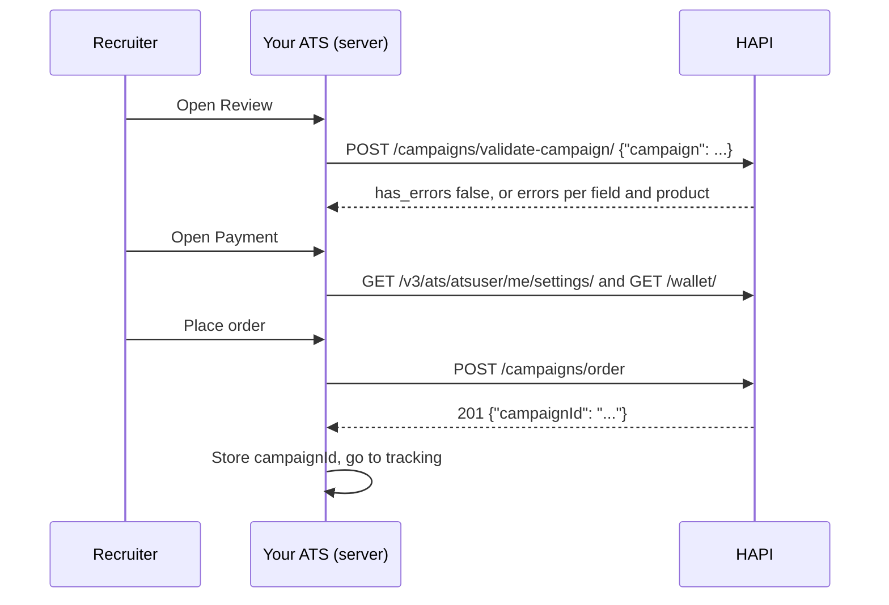

# Checkout and Order

> Wizard steps 3 and 4: the recruiter reviews the vacancy, sees what will be charged and how, and places the order. Your ATS assembles one order body, validates it, and submits it exactly once.

## UI Moment

- **Step 3, Review**: the vacancy data from the job (title, description, company and logo, location, salary, targeting, application URL) as an editable summary, with a **Validate** state: "Ready to post" or a list of problems.
- **Step 4, Payment**: the cart split in two. Marketplace products are paid to VONQ with a funding choice; contract products are billed by the board to the customer's own account. Then **Place order**.



## Integration Variants

| Decision | Options | What changes |
|----------|---------|--------------|
| Who bills the customer | `ats_managed` (your ATS invoices its customer), or a HAPI method: `wallet`, `purchase_order`, `direct_charge` | HAPI methods need the matching account setting and a wallet. See [Wallets & Payments](../guides/12-wallets-and-payments.md) |
| Validation timing | Progressive (vacancy on Review, channels in step 2, campaign before Place order), or once before Place order | Same endpoints; progressive gives earlier feedback |
| Campaign mix | Marketplace only, contracts only, or both in one order | One `campaignId` either way; all contracts must share one group |
| Strictness | Strict, or `?loose=true` | Loose validation lets configured vacancy fields be left out, only on accounts where VONQ enabled it |
| Status notifications | Account-level webhook URL, or `notifications.webhookUrl` per order | See [Campaign Tracking](./08-campaign-tracking.md) |

## Build

### Step 1: Assemble the order body

One body serves validation and ordering. It combines the job ([Job to Vacancy](./03-job-to-vacancy.md)), the cart ([Channel Selection](./04-channel-selection.md)) and the requirement answers ([Posting Requirements Form](./06-posting-requirements-form.md)):

```json
{
  "companyId": "<customer-id>",
  "campaignName": "Senior PHP Developer - Amsterdam",
  "recruiterInfo": { "name": "Jane Doe", "emailAddress": "jane.doe@example.com" },
  "postingDetails": { "title": "Senior PHP Developer", "...": "see Vacancy Fields" },
  "targetGroup": { "educationLevel": [], "seniority": [], "industry": [], "jobCategory": [] },
  "orderedProducts": [
    "9a3b7c1e-0f6d-4a52-8e31-2c4b5d6e7f80",
    "c1f2e3d4-b5a6-4789-9012-3456789abcde"
  ],
  "orderedProductsSpecs": [
    {
      "productId": "c1f2e3d4-b5a6-4789-9012-3456789abcde",
      "contractId": "c4d5e6f7-a8b9-0123-def0-234567890123",
      "postingRequirements": { "location": "3000" }
    }
  ],
  "paymentMethod": "ats_managed",
  "labels": { "checkout": "7f0c2a" }
}
```

| Field | Source |
|-------|--------|
| `companyId` | Your customer identifier; use the same value as `X-Customer-Id` |
| `recruiterInfo.name` | The recruiter placing the order (required) |
| `postingDetails`, `targetGroup` | The job. Field rules: [Vacancy Fields](../guides/08-campaigns/vacancy-fields.md) |
| `orderedProducts[]` | Every cart line: marketplace `product_id` values and the contract products' `product.product_id` values. Bundles by their own ID |
| `orderedProductsSpecs[]` | One entry per product that has a contract, posting requirement answers, or UTM parameters |
| `paymentMethod`, `walletId`, `poNumber` | The payment step (Step 3) |
| `campaignName`, `orderReference`, `labels`, `metadata` | Your own references. `labels` are filterable later (up to 5 pairs, 32 characters each) |

### Step 2: Validate on Review

```http
POST https://marketplace-sandbox.api.vonq.com/campaigns/validate-campaign/ HTTP/1.1
X-Auth-Token: <your Partner token here>
X-Customer-Id: <customer-id>
Content-Type: application/json

{ "campaign": { ...the order body... } }
```

- `200` with `has_errors: false`: show "Ready to post".
- `422` with `has_errors: true`: show `errors` next to the matching fields. Errors under `orderedProductsSpecs` and `orderedProducts` are lists in the same order as your request, so map them by position.

To check only the vacancy part while the recruiter edits the summary, use `POST /campaigns/validate-vacancy-info/` with `{"vacancy": {...}}`, holding `companyId`, `recruiterInfo`, `campaignName`, `postingDetails` and `targetGroup`. `POST /campaigns/order?validateOnly` runs the full order validation without creating anything. See [Campaign Validation](../guides/08-campaigns/validation.md).

### Step 3: Offer the payment methods the account allows

Read `GET /v3/ats/atsuser/me/settings/`:

| Setting | Payment option to show |
|---------|------------------------|
| `ats_managed_payment: true` | No payment choice in HAPI: your ATS bills the customer. Send `paymentMethod: "ats_managed"` |
| `can_use_wallets` | Pay from VONQ credits: `wallet` |
| `can_pay_with_purchase_order` | Invoice: `purchase_order` |
| `can_pay_with_direct_charge` | Pay for this campaign now: `direct_charge` |

For the HAPI methods, `GET /wallet/` gives the wallet `id` (send it as `walletId`), its `balance` and `has_billing_details`. Show the balance after purchase, and a top-up link when the balance does not cover the marketplace total. Contract products are never charged by VONQ; show them as billed by the board.

### Step 4: Place the order once

1. Disable **Place order** while the request is in flight. Ordering can take up to 30 seconds.
2. `POST /campaigns/order` with the order body as is (no wrapper). Add `?loose=true` only if you validated with it.
3. `201` returns `{"campaignId": "<uuid>"}` and a `Location` header. Store the ID and move to [Campaign Tracking](./08-campaign-tracking.md).
4. On a validation failure the body has the same `errors` / `has_errors` shape as Step 2. Treat `400` and `422` the same way.
5. On a timeout or connection error, do not resend straight away. Look the order up by its label first: `GET /campaigns?label[checkout]=7f0c2a&customerId=<customer-id>`. Resend only if nothing comes back.

With `direct_charge`, the order creates a campaign that waits for payment: embed the payment widget with the `walletId` and `campaignId` and wait for its success event. See [Direct Charge](../guides/12-wallets-and-payments.md#direct-charge-per-campaign-payment).

## Store

| What | Why |
|------|-----|
| `campaignId` | The only field in the order response; every later call uses it |
| The `X-Customer-Id` used for the order | Editing and Sandbox status simulation work only for the ordering customer |
| The submitted order body | Edits must resend fields that cannot change; reorders and duplicates start from it |
| `paymentMethod`, `walletId` | Billing records and refunds |
| The checkout label (for example `labels.checkout`) | Finds the order after a timeout without creating a second one |
| Per-product rows from `GET /campaigns/{campaignId}` | Bundles expand into their child products after ordering; track what HAPI returns, not the cart |

## Rules

1. The three endpoints wrap the same body differently: `validate-vacancy-info` takes `{"vacancy": ...}`, `validate-campaign` takes `{"campaign": ...}`, and `order` takes the body itself.
2. `postingDetails` needs all of `title`, `description`, `organization`, `workingLocation`, `yearsOfExperience`, `employmentType`, `jobPageUrl` and `applicationUrl`, plus exactly one of `weeklyWorkingHours` or `weeklyWorkingMinutes` (the latter only where the account enables it).
3. `postingDetails.organization.companyLogo` must be a publicly reachable URL. HAPI downloads it.
4. `validate-campaign` does not check that every product can still be ordered. The order itself can still fail on `orderedProducts`.
5. All contracts in one order must be in the same contract group, or the order returns `403` before any other check.
6. Always send `paymentMethod` explicitly. `ats_managed` with a `walletId` returns `400`. `wallet`, `purchase_order` and `direct_charge` need at least one product with a price, a `walletId`, and the method enabled for the account. Send `poNumber` with `purchase_order`.
7. `notifications.webhookUrl` must be an `https://` URL of at most 512 characters, and is only checked when ordering. To use the account-level URL, leave `notifications` out entirely.
8. There is no idempotency key. One click must produce one request; recover from timeouts by looking the order up by label (Step 4).
9. Accounts can have duplicate-order protection: a byte-identical body within the configured window is rejected, and so is validating a body that was just ordered. Include something unique per checkout (such as the label) so that intended reorders differ.
10. `?loose=true` on an account without loose validation is rejected.

## Validate

Run these against Sandbox. Sandbox accepts orders but never delivers them, so placing orders there is free; see [End-to-End Testing](./09-end-to-end-testing.md).

| ID | Given | When | Then |
|----|-------|------|------|
| `ORD-01` | A complete body for one marketplace product | `POST /campaigns/validate-campaign/` with `{"campaign": body}` | `200`, `has_errors: false` |
| `ORD-02` | The vacancy part of that body without `postingDetails.title` | `POST /campaigns/validate-vacancy-info/` with `{"vacancy": ...}` | `422`, `has_errors: true`, error under `postingDetails.title`; the Review step highlights the title |
| `ORD-03` | A valid body with a unique `campaignName` | `POST /campaigns/order?validateOnly=true`, then `GET /campaigns?campaignName=<name>` | `200` with `has_errors: false`; no campaign with that name exists |
| `ORD-04` | A valid body with `paymentMethod: "ats_managed"` and a `walletId` | `POST /campaigns/order` | `400`, error under `walletId` |
| `ORD-05` | A valid body with `notifications.webhookUrl: "http://example.com/hook"` | `validate-campaign`, then `order` | Validation passes; the order is rejected with an HTTPS error |
| `ORD-06` | Two contract products whose contracts are in different groups | `POST /campaigns/order` | `403` "All contracts must be part of the same contracts group" |
| `ORD-07` | A valid mixed body: one marketplace product and one contract product with posting requirements | `POST /campaigns/order`, then `GET /campaigns/{campaignId}` | `201` with `campaignId` and `Location`; the campaign lists both products with status `in progress` |
| `ORD-08` | The UI's Place order button | Double-click it, and separately simulate a timeout | Exactly one campaign exists for the checkout label |

## Done When

- [ ] One order body is built from the job, cart and requirement answers, and reused for validation and ordering.
- [ ] Validation errors are shown next to the right vacancy field or cart line, including positional product errors.
- [ ] Only the payment methods enabled for the account are offered, and contract products are shown as billed by the board.
- [ ] Place order sends exactly one request, and a timeout never creates a second campaign.
- [ ] `campaignId`, the ordering customer and the submitted body are stored.
- [ ] Scenarios `ORD-01` to `ORD-08` pass.

## Related

- [Campaign Ordering](../guides/08-campaigns/ordering.md) and [Vacancy Fields](../guides/08-campaigns/vacancy-fields.md): the full order body
- [Campaign Validation](../guides/08-campaigns/validation.md): endpoints, error shapes and positional errors
- [Wallets & Payments](../guides/12-wallets-and-payments.md): payment methods, wallets, the payment widget
- [Mixed Campaign](../guides/14-scenarios/mixed-campaign.md): marketplace and contract products in one order
- Next recipe: [Campaign Tracking](./08-campaign-tracking.md)
