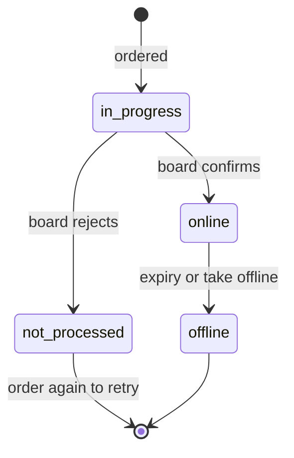

# Campaign Tracking

> Wizard step 5 and every visit to the job afterwards: show where the job is live, what failed and why, and let the recruiter change or stop it. Your ATS keeps the statuses current with webhooks and an incremental sync.

## UI Moment

- **Step 5, Done**: "Your job is going live", with one row per channel moving from **Delivering** to **Online** (with a **View on board** link and, later, clicks) or to **Not processed** (with an explanation and a hint to fix it).
- **The job's campaign tab**: the same rows for every campaign of the job, plus **Edit** and **Take offline** for the whole campaign or for one channel.



These are product statuses. A campaign is `in progress`, `online` (while at least one product is online) or `offline`.

## Integration Variants

| Decision | Options | What changes |
|----------|---------|--------------|
| How you learn about changes | Webhooks with an incremental-sync fallback (recommended), or incremental sync only | Webhooks must be enabled for your account by VONQ, per environment |
| Webhook URL | The account-level URL, or `notifications.webhookUrl` per order | The per-order URL only redirects deliveries; the account still needs webhooks enabled |
| Sync scope | One sync for all your campaigns, or per customer with `customerId` | One sync uses the least of your rate limit |
| Taking offline | Whole campaign, or one channel | Different endpoints and errors (Step 6) |

## Build

### Step 1: Show the first statuses after ordering

On the Done screen, call `GET /campaigns/{campaignId}/status`. It returns the campaign `status` and `orderedProductsStatuses[]` with `productId`, `status`, `statusDescription`, `statusSolution` and `statusRawError`.

Delivery takes minutes to hours, depending on the board (see each product's `time_to_process`). Poll slowly while the screen is open, then let the background sync (Step 4) take over. Do not keep a spinner running for hours.

### Step 2: Show links, dates and clicks

`GET /campaigns/{campaignId}` returns the full campaign. Per product in `orderedProductsSpecs[]`:

| Field | Show as |
|-------|---------|
| `status` | Status pill: `in progress`, `online`, `offline`, `not processed` |
| `jobBoardLink` | **View on board** link. Can be a placeholder such as the board's homepage, even before the product is online; use `status` to decide whether the posting is live |
| `deliveredOn` | "Live since" |
| `statusDescription`, `statusSolution`, `statusRawError` | Why a product is `not processed`, and what to do. Show as plain text |

`postings[]` holds `clicks` per `productId`. Clicks are cumulative and update with a delay. Products of an ordered bundle appear as separate entries; group them under the bundle using the `bundle_products_ids` you stored at selection time.

### Step 3: Receive webhooks

When VONQ enables campaign webhooks for your account, HAPI POSTs to your URL whenever a campaign changes:

```json
{
  "request_id": "6f1c2d3e-4b5a-4c6d-8e7f-9a0b1c2d3e4f",
  "campaign_id": "2b3c4d5e-6f70-4a81-92b3-c4d5e6f7a8b9",
  "modified_on": "2026-05-21T10:02:11.481Z"
}
```

1. Check the authentication headers VONQ configured for your account. Deliveries carry no signature.
2. Answer `2xx` immediately; do the work afterwards.
3. Fetch `GET /campaigns/{campaign_id}` and apply it only if its `modifiedOn` is newer than what you stored. The payload is a trigger, not data.

See [Campaign Webhooks](../guides/08-campaigns/webhooks.md).

### Step 4: Run an incremental sync

Deliveries are not retried, so run a sync on a schedule even with webhooks:

```http
GET https://marketplace-sandbox.api.vonq.com/campaigns?modifiedOn_gte=2026-05-21T09:00:00Z&sortBy=modifiedOn.asc&limit=50&offset=0 HTTP/1.1
X-Auth-Token: <your Partner token here>
```

Process each campaign, then move your stored cursor to the `modifiedOn` of the last one processed. Build the next page's URL yourself from your filters, `limit` and `offset`, and stop when you have read `total` campaigns. See [Incremental Sync](../guides/08-campaigns/status.md#incremental-sync).

### Step 5: Edit a live campaign

Offer **Edit** only when `isEditable` is `true`. Send the full order body with your changes to `PUT /campaigns/{campaignId}/edit`, with the same `X-Customer-Id` as the order, and resend fields that cannot change exactly as ordered. The response is `202`; the change reaches the boards asynchronously. See [Campaign Editing](../guides/08-campaigns/editing.md).

### Step 6: Take a campaign or channel offline

| Scope | Call | Body |
|-------|------|------|
| Whole campaign | `PUT /campaigns/{campaignId}/cancellation` | `{"campaignId": "<campaignId>", "status": "offline"}` |
| One channel | `PUT /campaigns/{campaignId}/product_cancellation` | `{"productId": "<productId>", "status": "offline"}` |

Both return `202`. Show "Taking offline", then confirm with `GET /campaigns/{campaignId}` before showing **Offline**. See [Campaign Cancellation](../guides/08-campaigns/cancellation.md).

## Store

| What | Why |
|------|-----|
| Per campaign: `campaignId`, ordering customer, `status`, `modifiedOn` | `modifiedOn` decides whether an update is newer than what you show |
| Per product: `productId`, `status`, `statusDescription`, `statusSolution`, `jobBoardLink`, `deliveredOn`, `clicks` | The status rows |
| The sync cursor (`modifiedOn` of the last processed campaign) | Next incremental sync |
| Takedown requests per product: requested, accepted, confirmed | Shows "Taking offline" until HAPI confirms |

## Rules

1. `not processed` is final. To retry, order again, for example by duplicating the stored order body with the problem fixed.
2. A campaign stays `online` while any of its products is online, even if others failed. Show per-product status, not only the campaign status.
3. `deliveredOn` is empty until a product is online. `jobBoardLink` can be a placeholder such as the board's homepage, even while the product is `in progress`, and some boards keep the placeholder once online. Use `status` to decide whether a posting is live, and the link only for display.
4. Some boards never report expiry, so a product can stay `online` after its run has ended. Compare `deliveredOn` with the product's duration before calling it live.
5. Render `statusSolution` and `statusRawError` as text, never as HTML.
6. Webhooks arrive in batches every few minutes, coalesce intermediate changes, and are not sent for the order itself. Never rely on seeing every status in between.
7. The webhook URL must be public HTTPS and final: redirects are not followed.
8. Use `modified_on` and `modifiedOn` to discard stale updates. Deliveries are not retried, and the same change can reach you through both the webhook and the sync.
9. All `/campaigns` calls share one rate limit budget. Prefer webhooks plus one incremental sync over polling every campaign.
10. Editing works only when `isEditable` is `true`, with the ordering customer's `X-Customer-Id`, and not for CPA+ products. Edits within 5 minutes of each other collapse into the last one.
11. Taking one channel offline that is not `online` returns `400`. Taking a campaign offline that is not online returns `202` without doing anything, or `400` if your account is set to report it. See [Cancelling a Non-Online Campaign](../guides/08-campaigns/cancellation.md#cancelling-a-non-online-campaign).
12. HAPI acts on any campaign of your partner account. Check in your ATS that the recruiter may manage the campaign before editing or taking it offline.

## Validate

Sandbox never delivers, so statuses stay `in progress` until you move them with [status simulation](../guides/08-campaigns/status.md#sandbox-status-simulation) (`PATCH /campaigns/{campaignId}/edit`, Sandbox only). Use the same `X-Customer-Id` as the order.

| ID | Given | When | Then |
|----|-------|------|------|
| `TRK-01` | A fresh Sandbox order | `GET /campaigns/{campaignId}/status` | `200`, campaign and products `in progress`; the UI shows **Delivering** |
| `TRK-02` | `TRK-01` | Simulate `status: "online"` with one product `online`, a `deliveredOn` and a `jobBoardLink`; then `GET /campaigns/{campaignId}` | Campaign and product `online`, link and date set, `modifiedOn` newer; the UI shows **Online** with **View on board** |
| `TRK-03` | Another fresh order | Simulate the product `not processed` with a `statusSolution` | The UI shows **Not processed** with the solution as plain text and offers to order again |
| `TRK-04` | Webhooks enabled on Sandbox, a public HTTPS URL | Run `TRK-02` | A POST with `request_id`, `campaign_id`, `modified_on` arrives within a few minutes; your receiver answers `2xx` and the campaign row updates |
| `TRK-05` | A cursor from before `TRK-02` | `GET /campaigns?modifiedOn_gte=<cursor>&sortBy=modifiedOn.asc` | The simulated campaign is returned; the cursor moves to its `modifiedOn` |
| `TRK-06` | A product still `in progress` | `PUT /campaigns/{campaignId}/product_cancellation` | `400` "Product is not online." |
| `TRK-07` | `TRK-02` | `PUT /campaigns/{campaignId}/product_cancellation` for the online product, then `GET /campaigns/{campaignId}` | `202`; the product reads `offline`, and so does the campaign if it was its last online product |
| `TRK-08` | An online campaign | `PUT /campaigns/{campaignId}/cancellation` with a different `campaignId` in the body | `400`; with the matching ID, `202` and the campaign reads `offline` |

## Done When

- [ ] Step 5 shows one row per ordered product, including bundle children, and never spins indefinitely.
- [ ] `not processed` products show the reason and a way to order again.
- [ ] Statuses stay current through webhooks (if enabled) and a scheduled incremental sync, and never move backwards.
- [ ] Edit is offered only for editable campaigns; takedowns are confirmed before showing Offline.
- [ ] Scenarios `TRK-01` to `TRK-08` pass (`TRK-04` once VONQ has enabled webhooks for your Sandbox account).

## Related

- [Status & Lifecycle](../guides/08-campaigns/status.md): statuses, simulation, incremental sync
- [Campaign Webhooks](../guides/08-campaigns/webhooks.md): setup and authentication
- [Campaign Editing](../guides/08-campaigns/editing.md) and [Campaign Cancellation](../guides/08-campaigns/cancellation.md)
- [Bundles in Campaigns](../guides/08-campaigns/bundles.md): bundle children in the campaign response
- Next recipe: [End-to-End Testing](./09-end-to-end-testing.md)
