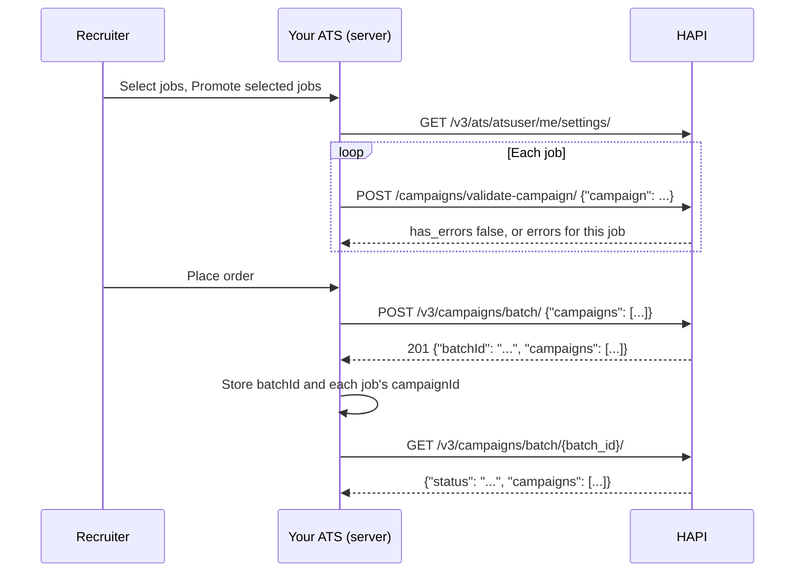

# Batch Ordering

> Let a recruiter promote up to 20 jobs in one go. Your ATS builds one order per job, validates each, and places them in one call: all of them are created, or none is. One `batchId` then follows them and takes them offline together.

## UI Moment

- **Job list**: the recruiter selects several jobs and chooses **Promote selected jobs**. The action is offered for 2 to 20 jobs, and only on accounts that can use it (Step 1).
- **Channels and requirements**: the same steps as for one job ([Channel Selection](./04-channel-selection.md) and [Posting Requirements Form](./06-posting-requirements-form.md)), with every selected job listed and a completion mark per job. Where the account has SmartFill, each job's requirements arrive prefilled for the recruiter to check.
- **Review**: one row per job, each with its own state: "Ready to post" or the list of problems for that job. **Place order** stays disabled until every job is ready.
- **Done**: one row per job, moving from **Delivering** to **Online** or **Not processed** as in [Campaign Tracking](./08-campaign-tracking.md), with **Take all offline** next to the per-job actions.

## Integration Variants

| Decision | Options | What changes |
|----------|---------|--------------|
| Channels | The same channels for every job, or chosen per job | Nothing in the API: every campaign carries its own `orderedProducts` |
| Channel requirements | Filled by hand, prefilled with SmartFill per job, copied from another job, or a mix, always confirmed per job | SmartFill suits answers that depend on the job (location, category, salary); copying suits account-level answers that repeat (an application method, a company page). See [Prefilling answers with SmartFill](#prefilling-answers-with-smartfill-optional) and [Copying answers between jobs](#copying-answers-between-jobs-optional) |
| Validation timing | As each job's requirements are completed, or all at once on Review | Same endpoint. Validating as you go spreads the calls out and shows problems earlier |
| Tracking | The batch overview, each campaign on its own, or both | `GET /v3/campaigns/batch/{batch_id}/` gives one status for all jobs; webhooks and the incremental sync keep working per campaign |
| Taking offline | The whole batch, or job by job | Both stay available after a batch is created |

## Build

### Step 1: Offer the action only where it works

Read `GET /v3/ats/atsuser/me/settings/` for the customer. Offer **Promote selected jobs** only when `ats_managed_payment` is `true`: a batch cannot be paid through HAPI, so every campaign of it is billed by your ATS. Limit the selection to 20 jobs, and leave CPA+ products out of the channels you offer for a batch. The same response tells you whether SmartFill is available: `settings.smartfill.posting_requirements`.

### Step 2: Build one order body per job

Build each job's body exactly as in [Checkout and Order, Step 1](./07-checkout-and-order.md#step-1-assemble-the-order-body), with:

- `paymentMethod: "ats_managed"` and no `walletId`
- a label shared by every campaign of this checkout, for example `labels.checkout`, and one that names the job, for example `labels.job`
- something unique per job, such as its own title and `campaignName`, so that duplicate-order protection does not reject two campaigns as copies of each other

Keep the bodies in the order the recruiter will see them: every response refers to the campaigns by position.

#### Prefilling answers with SmartFill (optional)

When SmartFill is available, prefill each job the way a single job is prefilled ([Posting Requirements Form, Step 4](./06-posting-requirements-form.md#step-4-prefill-optional)): one `POST /v3/smartfill/posting-requirements/` per job and cart line, with that line's `contract_id` or `product_id` and that job's own context, then poll `GET /v3/smartfill/posting-requirements/{task_id}/` every 5 seconds until it is `completed` or `errored`. See [Smartfill](../guides/07-posting-requirements/smartfill.md).

With several jobs, that is many tasks at once:

- Start the tasks a few at a time, beginning with the jobs the recruiter sees first, and start more as they finish. Polling every running task every 5 seconds adds up quickly: keep it within the budget of the rest of your traffic ([Rate Limits](../02-api-overview.md#rate-limits)) and back off on `429`.
- Prefill each job from its own task. Its suggestions come from that job's context; copy between jobs only the answers that repeat (below).
- Fill only empty fields, and never block the recruiter on a task. A task typically takes 5 to 60 seconds; a job whose task errors or returns nothing is filled in by hand.
- Show prefilled answers as suggestions until the recruiter confirms them, then validate the job (Step 3).

#### Copying answers between jobs (optional)

Many requirement answers are the same for every job of a customer, such as an application method, a company page or an ad template. A **Copy answers from another job** action saves the recruiter from filling them in up to 20 times. To keep copied answers valid:

- Copy only between cart lines of the same board and the same contract. Options loaded through Autocomplete come from the contract's board account, so another contract's values may not exist there.
- Copy a field together with the fields that depend on it, or not at all. When a copied value differs from the job's own (a location, for example), clear its dependent fields as you would when the recruiter changes it; see [Posting Requirements Form, Step 3](./06-posting-requirements-form.md#step-3-load-options-on-demand).
- Copy `postingRequirementsLabels` along with the values, so copied answers show their labels.
- Leave out answers that describe the job, such as its location, category or salary, unless the recruiter picks them.
- Show copied answers as copied until the recruiter confirms them, and validate the job again (Step 3).

### Step 3: Validate each job

Send each body to `POST /campaigns/validate-campaign/`, wrapped as `{"campaign": ...}`, and show the result on that job's row. The responses and error shapes are those of [Checkout and Order, Step 2](./07-checkout-and-order.md#step-2-validate-on-review).

<!-- theme: warning -->
> ### Creating a Batch Does Not Ask the Job Boards
> `POST /v3/campaigns/batch/` runs every check of a single order except the job boards' own check of the posting requirements. A campaign that a board would reject is created anyway, and its product ends `not processed` on that board. Validating each job first is what catches those problems.

Run the validations one after another or a few at a time, within the [rate limit](../02-api-overview.md#rate-limits). Validate again any job whose answers change after its last validation.

### Step 4: Place the batch once

1. Disable **Place order** while the request is in flight. A batch takes longer than a single order.
2. `POST /v3/campaigns/batch/` with `{"campaigns": [...]}`, holding the bodies exactly as validated, without the `{"campaign": ...}` wrapper. Add `?loose=true` only if you validated with it.
3. `201` returns the `batchId` and one `campaignId` per campaign, in the order sent. Store the `batchId`, map each `campaignId` back to its job by position, and move to Step 5.
4. When any campaign is refused, nothing is created. `campaigns` in the response holds one entry per job, in the order sent: `{}` for a job that passed and that job's errors for a refused one. Show each entry on its job's row; `errorDetails` paths start with `campaigns.<position>`. A request that is wrong as a whole, such as more than 20 campaigns, returns `400` with errors on `campaigns`. See [Batch Ordering - Errors](../guides/08-campaigns/batch-ordering.md#errors).
5. On a timeout or connection error, do not resend straight away. Look the campaigns up by the shared label first: `GET /campaigns?label[checkout]=<value>&customerId=<customer-id>`. A batch is created whole or not at all, so you find every job's campaign or none. Resend only if nothing comes back. If the campaigns exist, follow and take them offline one by one, since the `batchId` arrives only in the `201` response.

### Step 5: Follow the batch

`GET /v3/campaigns/batch/{batch_id}/` returns each campaign's `status` in the order sent and one `status` for the batch:

| Batch `status` | Show |
|----------------|------|
| `online` | At least one job is live |
| `offline` | Every job is offline |
| `in progress` | Otherwise |

Each campaign is still a regular campaign: keep its rows current with webhooks and the incremental sync as in [Campaign Tracking](./08-campaign-tracking.md), and use its `campaignId` for edits and per-channel takedowns.

### Step 6: Take the batch offline

**Take all offline** calls `PUT /v3/campaigns/batch/{batch_id}/cancellation/`. The `202` response gives each campaign's `result`:

- `accepted`: the campaign is taken offline in the background. Show it as being taken offline until its status is `offline`.
- `refused`: show the campaign's `error`, which is the error a single [cancellation](../guides/08-campaigns/cancellation.md) would return.

Follow the batch's `status` until it is `offline`.

## Store

| What | Why |
|------|-----|
| `batchId` | Follows and cancels the batch. Single campaign reads do not return it |
| Each job's `campaignId` | Every per-campaign call: tracking, edits, per-channel takedowns |
| The order of the jobs in the request | Maps the response, refusals and `errorDetails` back to jobs |
| The submitted body per job | Edits and reorders start from it, as for a single order |
| The shared checkout label | Finds the campaigns after a timeout without creating them twice |
| The `X-Customer-Id` used | A batch belongs to that customer; a customer JWT only sees its own batches |

## Rules

1. A batch holds 1 to 20 campaigns, all for the customer of the request's `X-Customer-Id` or JWT.
2. A batch is all or nothing: one refused campaign means none is created.
3. A campaign with a `walletId` is refused, and the HAPI payment methods need one, so every campaign of a batch is `ats_managed`. Accounts without `ats_managed_payment` cannot use batches.
4. A campaign ordering a CPA+ product is refused.
5. Creating a batch does not run the job boards' checks of the posting requirements. Validate each campaign first.
6. The HTTP status of a refused batch is the highest of its refused campaigns, `400` or `403`. Read every entry of `campaigns`, not only the status.
7. `?validateOnly` and `?verbose` do not apply to a batch; it always creates. `?loose=true` applies to every campaign of it.
8. Duplicate-order protection applies to each campaign, against earlier orders and against the other campaigns of the same batch.
9. There is no idempotency key. One click must produce one request; recover from timeouts with the shared label (Step 4).
10. Each campaign of a batch keeps its own status, webhooks, edits and cancellations. There is no webhook for the batch as a whole.

## Validate

Run these against Sandbox. Sandbox accepts batches but never delivers them, and campaign statuses only move with [status simulation](../guides/08-campaigns/status.md#sandbox-status-simulation); see [End-to-End Testing](./09-end-to-end-testing.md).

| ID | Given | When | Then |
|----|-------|------|------|
| `BAT-01` | An account with `ats_managed_payment: false` | Open the job list with several jobs selected | **Promote selected jobs** is not offered |
| `BAT-02` | Two valid bodies with different titles and a shared `labels.checkout` | Validate each, then `POST /v3/campaigns/batch/` | `201` with a `batchId` and two `campaignId`s; `GET /campaigns?label[checkout]=<value>` returns both campaigns |
| `BAT-03` | Three bodies, the second with an empty `companyId` | `POST /v3/campaigns/batch/` | `400`; `campaigns` is `[{}, {...errors...}, {}]`; the label lookup returns no campaign; the second job's row shows the error |
| `BAT-04` | 21 valid bodies | `POST /v3/campaigns/batch/` | `400` with an error on `campaigns`; no campaign exists |
| `BAT-05` | A valid body with `paymentMethod: "wallet"` and a `walletId` | `POST /v3/campaigns/batch/` with it and one other valid body | `400`; its entry is `{"error": "A campaign of a batch cannot be paid from a wallet"}`; no campaign exists |
| `BAT-06` | Two bodies that are byte-identical, on an account with duplicate-order protection | `POST /v3/campaigns/batch/` | The second campaign is refused as a duplicate; no campaign exists |
| `BAT-07` | The batch from `BAT-02`, both campaigns simulated `online` | `GET /v3/campaigns/batch/{batch_id}/` | `status: online`, each campaign `online`, in the order sent |
| `BAT-08` | `BAT-07` | `PUT /v3/campaigns/batch/{batch_id}/cancellation/`, then read the batch until it changes | `202` with `result: accepted` for both; the batch reaches `status: offline` |
| `BAT-09` | The batch from `BAT-02` and a customer JWT for another customer | `GET /v3/campaigns/batch/{batch_id}/` with that JWT | `404` |
| `BAT-10` | The UI's Place order button | Double-click it, and separately simulate a timeout | Exactly one campaign per job exists for the checkout label |
| `BAT-11` | Two jobs with different locations, on a board whose job category depends on the location | Copy the answers from the first job to the second | The second job's job category is cleared or flagged, not copied as is; validating the second job passes once it is filled |
| `BAT-12` | An account with `settings.smartfill.posting_requirements: true` and 10 jobs on a contract line with posting requirements | Open the requirements step | Tasks start a few at a time with each job's own context; every job is prefilled from its own task or left for manual input; no request returns `429`; nothing is submitted before the recruiter confirms |

## Done When

- [ ] **Promote selected jobs** appears only for 2 to 20 jobs, on accounts with `ats_managed_payment`, and without CPA+ products.
- [ ] One body is built per job, with `ats_managed`, a shared checkout label and a unique title.
- [ ] Every job is validated before Place order is enabled, and each job shows its own result.
- [ ] Place order sends exactly one batch request, and a timeout never creates the campaigns twice.
- [ ] A refused batch shows each job's errors on that job, by position.
- [ ] `batchId`, each job's `campaignId` and the submitted bodies are stored.
- [ ] The batch status, per-job statuses and **Take all offline** work, and each job can still be tracked and taken offline on its own.
- [ ] Where SmartFill is available, each job is prefilled from its own task, a few tasks at a time, without blocking the recruiter.
- [ ] Copied answers stay within one board and contract, keep dependent fields consistent, and are confirmed by the recruiter.
- [ ] Scenarios `BAT-01` to `BAT-12` pass.

## Related

- [Batch Ordering](../guides/08-campaigns/batch-ordering.md) and its [Endpoint Reference](../guides/08-campaigns/batch-ordering.endpoints.md): request and response details
- [Checkout and Order](./07-checkout-and-order.md): building, validating and placing one order
- [Campaign Tracking](./08-campaign-tracking.md): statuses, webhooks and takedowns per campaign
- [Campaign Validation](../guides/08-campaigns/validation.md): endpoints and error shapes
